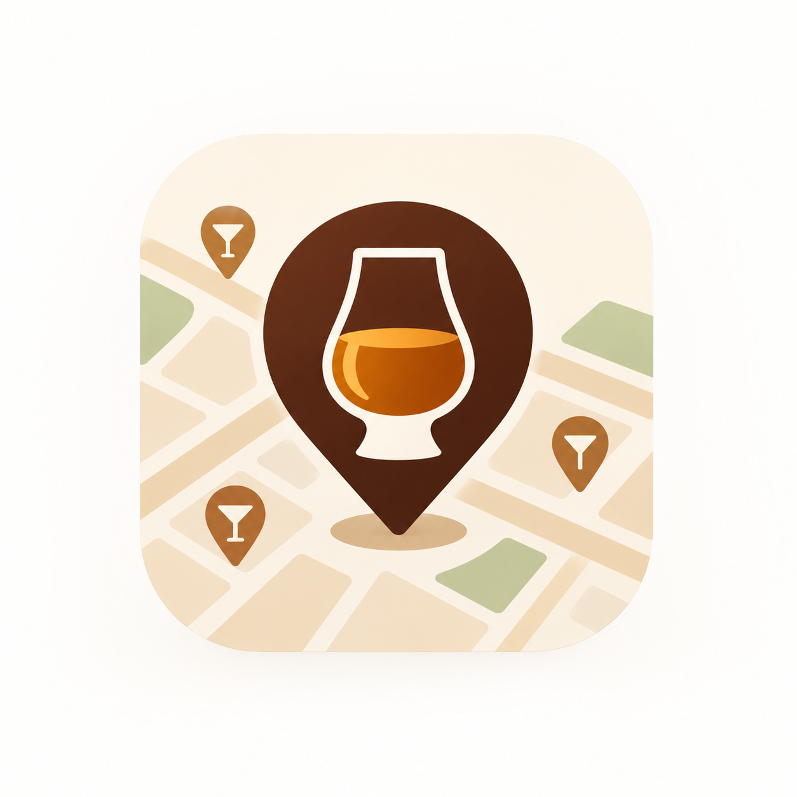

# BottleMap

<p align="center">
  
</p>

<p align="center"><strong>Find the bottle first, then the bar.</strong></p>

BottleMap is an Android application for drinkers who want to find bars serving a specific whisky. It turns bar-menu photos into structured, searchable menu data using AI, then lets customers search for a whisky and discover bars that currently serve it.

Developed by **Team 19 — Zero to One** for the SNU Software Development Principles and Practices course.


## Team

**Team 19 — Zero to One**
- Nam Hojin — Android Frontend / Product Definition 
- Yang Haeul — Backend / Integration (Iteration 3 PM)
- Park Jinwoo — AI


## Iteration 3

Iteration 3 focused on the **owner side**: bar owners now register their bar, import a menu from photos, review and publish it, and manage the bar themselves. The app is one Android build; Customer search is the first screen and the Owner entry is in My Page.

```text
Owner (Google sign-in)
→ apply to own an existing bar or register a new one
  (business certificate OCR, bar info, menu photos)
→ operator approval
→ AI extraction and matching → review and edit
→ publish the menu
→ manage the bar (menu prices, sold-out items, hours, tags, closures)

Customer (guest or Google sign-in)
→ whisky search or popular whiskies
→ serving-bar results → bar detail → map
```

### Demo Video

[Iteration 3 demo video link](https://drive.google.com/file/d/1JVYDqwHtjMStlmXJknWy8VI7wWZI1q8O/view?usp=drive_link)

Demo order:
- **Owner:** apply to register a bar (business certificate OCR, bar info, menu photos) → check the application status → AI reads the menu photos → match items to the catalog and review → publish the menu → manage the menu (prices per volume, sold out) → manage bar info (hours, tags, closures)
- **Customer:** search for a whisky → compare bars by price or distance → see prices on the map → open the bar's menu with the item highlighted → bar detail (hours, call, directions) → explore bars on the map


## Features Demonstrated in Iteration 3

### Owner
- Apply to own an existing bar, or apply to register a new bar with a cover photo
- Business certificate check: the photo is read by OCR and the registration is verified with the National Tax Service before applying
- Menu import from several photos: AI extraction and catalog matching, then a review screen to confirm, fix, or exclude each item before publishing
- Bar management after approval: manual menu edits, sold-out marking, sales info confirmation, bar description and tags, weekly opening hours and temporary closures, and bar photos

### Operator
- Web dashboard to approve or reject owner applications

### Customer
- Popular whiskies on the home screen, ranked by search counts over the last 30 days
- Bar detail with the opening status, description, tags, and photos added by the owner
- Everything from Iteration 2: guest or Google sign-in, whisky search by Korean or English name or alias, bar detail, Kakao Map, and nearby-bar discovery

### Backend
- APIs for owner applications and approval, business certificate reading and verification, menu edits, opening hours, bar photos, and popular whiskies
- Permissions checked on the server for every route: operator, the bar's approved owner, or public

### AI / Data
- Hybrid menu extraction: CLOVA OCR lines and the photo go to Gemini together
- Staged matching rules (exact alias, then S1 to S3); an LLM matching layer and an embedding candidate step are implemented behind settings
- Business certificate reading
- Catalog additions for Iteration 3 with Korean aliases

### CI/CD
- **Backend CI/CD:** tests on PostgreSQL; fails below 98% line + branch coverage, below the minimum test count, or on an unlisted skip. `main` is deployed to the server after the tests pass
- **Android CI:** lint, JVM unit tests with a JaCoCo coverage report, and the debug APK build; Owner Compose UI tests with coverage on an API 35 emulator. A merge to `main` builds `bottlemap-prod-debug-apk` against the deployed server
- **AI CI:** AI unit tests with per-module coverage and a check that fails when tests are deleted or skipped

## Tech Stack

**Android:** Kotlin, Jetpack Compose, Material 3, Navigation Compose, ViewModel, Retrofit, OkHttp, Moshi, Kakao Maps SDK, Supabase Auth (Google sign-in)  
**Backend:** FastAPI, PostgreSQL, SQLAlchemy, Alembic  
**AI:** CLOVA OCR + Gemini (hybrid extraction), catalog aliases with staged matching rules  
**Deployment:** AWS EC2, RDS, S3, Caddy/HTTPS, GitHub Actions

## Repository Structure

```text
.
├── android/     Android app
├── backend/     FastAPI server, matching, extraction adapters, tests
├── ai/          catalog, extraction/OCR/matching experiments, evaluation, AI tests
├── eval/        evaluation data
├── docs/        API spec, schema, matching flow, images
├── .github/     CI/CD workflows
└── README.md
```

## Getting Started

### Prerequisites
- Android Studio, JDK 17, Android SDK 37 (minimum SDK 26)
- Android device or emulator; location and camera features need a real device

### Clone

```bash
git clone https://github.com/snuhcs-course/swpp-2026-project-team-19.git
cd swpp-2026-project-team-19
```

### Build Settings

Pass these as Gradle properties (`-P...` or `~/.gradle/gradle.properties`). Never commit real keys; ask the team for them.

| Property | Needed for |
|---|---|
| `BOTTLEMAP_API_BASE_URL` | Backend URL. Deployed server: `https://bottlemap.o-r.kr/`. Debug default: `http://10.0.2.2:8000/` (emulator → local backend) |
| `BOTTLEMAP_KAKAO_NATIVE_APP_KEY` | Kakao Map. The app's package and signing-key hash must be registered in Kakao Developers |
| `BOTTLEMAP_SUPABASE_URL`, `BOTTLEMAP_SUPABASE_PUBLISHABLE_KEY`, `BOTTLEMAP_GOOGLE_WEB_CLIENT_ID` | Google sign-in. Needed for owner features; guest search does not need it |

### Build

| Variant | Contents | Command |
|---|---|---|
| `Debug` | Customer search at startup; Owner screens from My Page | `./gradlew :app:assembleDebug` |
| `Release` | Same unified source set (separate release signing/config required) | `./gradlew :app:assembleRelease` |

Example for the deployed backend (Windows: `.\gradlew.bat`):

```bash
./gradlew :app:assembleDebug \
  -PBOTTLEMAP_API_BASE_URL=https://bottlemap.o-r.kr/ \
  -PBOTTLEMAP_KAKAO_NATIVE_APP_KEY=<key> \
  -PBOTTLEMAP_SUPABASE_URL=<url> \
  -PBOTTLEMAP_SUPABASE_PUBLISHABLE_KEY=<key> \
  -PBOTTLEMAP_GOOGLE_WEB_CLIENT_ID=<client-id>
```

Debug APK output: `android/app/build/outputs/apk/debug/`.

Without the keys, download the APK from Android CI: each merge to `main` that changes the Android app uploads `bottlemap-prod-debug-apk`, built against the deployed server and signed with the team's registered debug keystore.

To build and install on a connected device (USB debugging on), use `installDebug` with the same properties:

```bash
./gradlew :app:installDebug -PBOTTLEMAP_API_BASE_URL=https://bottlemap.o-r.kr/ ...
```

## Backend

The deployed server is `https://bottlemap.o-r.kr/` (AWS EC2, RDS PostgreSQL, S3). A merge to `main` deploys it automatically after Backend CI passes; `GET /health` returns the commit it runs, and Swagger UI is at `/docs`.

For development, run the backend locally with `MENU_EXTRACTOR=mock`, which needs no API keys. Setup, seed data, and every setting are in [`backend/README.md`](backend/README.md); deployment is in [`backend/DEPLOY.md`](backend/DEPLOY.md).

```bash
cd backend
cp .env.example .env
uv sync
uv run --env-file .env alembic upgrade head
uv run --env-file .env uvicorn app.main:app --reload    # http://127.0.0.1:8000
```

## Testing

```bash
# Android
./gradlew :app:lintDebug
./gradlew :app:createDebugUnitTestCoverageReport                 # JVM unit tests + JaCoCo report
./gradlew :app:connectedDebugAndroidTest                         # Compose UI tests (emulator or device)
./gradlew :app:assembleDebug

# Backend (PostgreSQL test database, see backend/README.md)
cd backend && uv run --env-file .env pytest --cov

# AI (commands and policy in the Testing Documentation, section 2.1)
pytest ai
```

Iteration 3 results (details in the Testing Documentation):
- **Backend:** 2,503 tests passed, 99.62% line + branch coverage
- **AI:** 253 tests (252 passed, 1 allowed skip that needs live CLOVA keys); coverage targets met for all four modules
- **Android:** 396 JVM unit tests (JaCoCo: 15.00% line, 17.97% branch; reported, not enforced) and 94 Compose UI tests on an API 35 emulator (JaCoCo: 28.57% line, 22.21% branch). The two reports are measured separately and not combined

## Known Limitations and TODOs

- **Processing time:** reading one menu photo takes about 50 seconds. Processing runs inside the API process, so a server restart during processing can leave an import in `processing`.
- **Menu coverage:** only whisky items are imported; cocktails and food are left out. Menus that exist only as a web page (for example, a QR-code menu) cannot be imported yet.
- **Several volumes:** how to show one menu item sold in several volumes is not settled yet.
- **Matching:** Menus written in Korean transliteration are still often left for the owner to match.
- **Usability:** UI tests cover the key flows, but real-device testing with users is still needed.


## Documentation

Project documents are in the [GitHub Wiki](https://github.com/snuhcs-course/swpp-2026-project-team-19/wiki):
- Proposal
- Requirements and Specifications
- Design Documentation
- Testing Documentation
- AI Collaboration Reports and Prompt Logs (Iterations 1 to 3)
- Risk Management
- Daily Standup Meeting Log
- Pilot Survey Results


