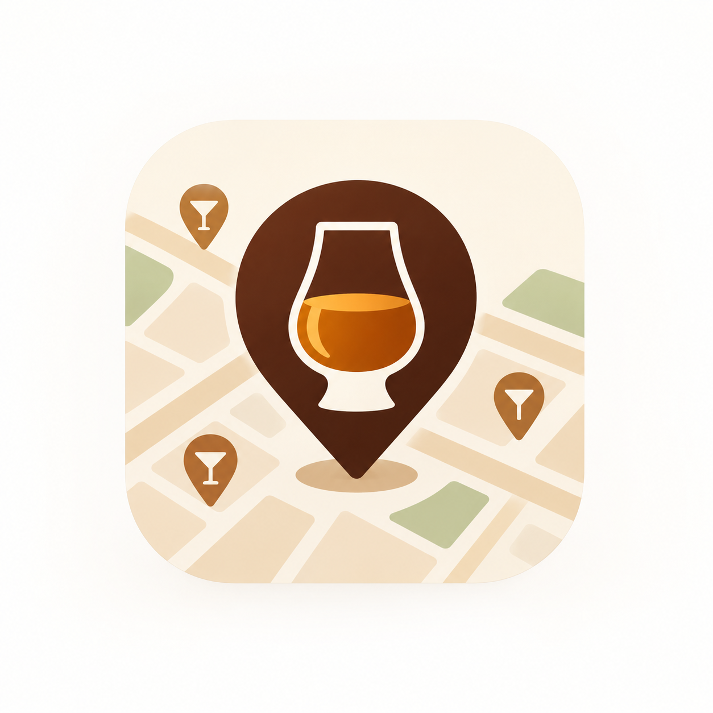

# BottleMap

<p align="center">
  
</p>

<p align="center"><strong>Find the bottle first, then the bar.</strong></p>

BottleMap is an Android application for drinkers who want to find bars serving a specific whisky. It turns bar-menu photos into structured, searchable menu data using AI, then lets customers search for a whisky and discover bars that currently serve it.

Developed by **Team 19 — Zero to One** for the SNU Software Development Principles and Practices course.


## Team

**Team 19 — Zero to One**

- Nam Hojin — Android Frontend / Product Definition 
- Yang Haeul — Backend / Integration / Owner Web
- Park Jinwoo — AI


## Iteration 4

Iteration 4 focused on **usability and acceptance testing**: a Welcome screen and Search / My Info bottom tabs make the two roles easier to find, while the photo-menu review uses cards with source-photo crops, grouped items and explicit price choices. Server-backed review drafts, recovery fixes and operator checks support the owner flow. The first Owner web release adds sign-in and bar applications; bar management remains in the Android app.

```text
Welcome (first launch)
→ Google sign-in / browse as a guest / register a bar
→ Search and My Info tabs, each retaining its own screen history

Owner (Google sign-in, from My Info or Welcome)
→ apply to own an existing bar or register a new one
  (business certificate OCR or manual input, business check, bar info, menu photos)
→ operator approval
→ AI extraction and matching → card-based review, edit and price selection
→ publish the bar menu
  (whiskies without a catalog product enter search after operator linking)
→ manage the bar (menu prices, sold-out items, hours, tags, closures)

Customer (guest or Google sign-in)
→ whisky search or popular whiskies
→ serving-bar results → bar detail and in-menu search → map
```

### Demo Video

[Iteration 4 demo video link](https://drive.google.com/file/d/1JmyATWM1dK3r5mzu7QHvKvYIeJNcwihp/view?usp=drive_link)

Demo order:

- **Owner:** enter from Welcome or My Info → apply to register a bar (business certificate OCR, business check, bar info, menu photos) → operator approval → review the AI results with photo crops, product choices and price choices → publish the menu → manage menu prices, sold-out items, hours, tags and closures
- **Customer:** browse as a guest → search for a whisky → compare bars by price or distance → see prices on the map → open the bar's menu with the item highlighted → search within the menu → bar detail (hours, call, directions) → explore bars on the map


## Features Demonstrated in Iteration 4

### Owner

- Apply to own an existing bar, or apply to register a new bar with a cover photo
- Business certificate check: the photo is read by OCR and the registration is verified with the National Tax Service before applying
- Menu import from up to 15 photos: AI extraction and catalog matching, followed by card-based review with source-photo crops, grouped lines, product confirmation/search, price conflicts and serving-size choices
- Save and resume review drafts, exclude items, and confirm the proposed changes before publishing; existing menu items outside the reviewed changes are retained
- Publish a whisky missing from the catalog to the bar's menu immediately; it appears in whisky search only after an operator links it to a catalog product. Non-whisky drinks can be added manually without catalog linking
- Bar management after approval: manual menu edits, sold-out marking, sales info confirmation, bar description and tags, weekly opening hours and temporary closures, and bar photos
- Owner web at `/owner/`: Google sign-in and existing-bar/new-bar applications, including certificate OCR, business checks, browser text drafts and upload retry. Application-status and bar-management pages are still placeholders

### Operator

- Web dashboard to approve or reject owner applications, with warnings when business registration numbers are shared
- Review menu-item checks, link uncatalogued whiskies, and manage catalog/alias changes
- Reset business-check and certificate-OCR request counts without restarting the server

### Customer

- Popular whiskies on the home screen, ranked by search counts over the last 30 days
- Bar detail with the opening status, description, tags, and photos added by the owner
- Welcome choices for Google sign-in, guest browsing or bar registration; Search (`검색`) and My Info (`내 정보`) bottom tabs retain their own navigation state; full-screen sign-in and photo selection/processing/review hide the tabs
- Search within a bar's menu, with local-name matching and server product/alias lookup, plus loading, error and retry states
- Everything from Iteration 3: guest or Google sign-in, whisky search by Korean or English name or alias, bar detail, Kakao Map, and nearby-bar discovery

### Backend

- APIs for owner applications and approval, business certificate reading and verification, menu edits, opening hours, bar photos, and popular whiskies
- Server review drafts, publishing without a catalog product, rematching renamed lines, merged-line review, and operator menu-item checks
- Automatic recovery of unfinished imports after a server restart, bounded to three resumes; business registration number encryption
- Business verification allows 30 checks per account per day; certificate OCR keeps its separate limit of 5
- Permissions checked on the server for every route (public, signed-in user, applicant, approved owner, or operator; spec 2.2)

### AI / Data

- Hybrid menu extraction: CLOVA OCR lines and the photo go to Gemini together
- Staged matching rules (exact alias, then S1 to S3), an LLM matching layer (Gemini), and embedding candidates for owner confirmation. Only deterministic rules automatically confirm a product; the LLM and embeddings suggest candidates
- Iteration 4 matching rules, linking guards, stored review states and checks of the reviewer's chosen product, plus offline regression checks on 15 labeled photos
- Extraction prompt v2 classifies whisky and non-whisky lines and has been evaluated; prompt v1 remains the server default
- PDF extraction is implemented and tested, but PDF upload is not connected to the app/API
- Similar-product suggestions in customer search remain disabled by default
- Business certificate reading and catalog additions with Korean aliases

### CI/CD

- **Backend CI/CD:** tests on PostgreSQL; fails below 98% line + branch coverage, below the minimum test count, or on an unlisted skip. `main` is deployed to the server after the tests pass
- **Android CI:** lint, JVM unit tests with a JaCoCo coverage report, and the debug APK build; instrumentation tests, including Compose UI tests, with coverage on an API 35 emulator. A merge to `main` builds `bottlemap-prod-debug-apk` against the deployed server
- **AI CI:** AI unit tests with per-module coverage, offline photo/name-case regressions, and minimum-count and approved-skip checks
- **Owner web CI/CD:** typecheck, Vitest tests, build, and generated OpenAPI type drift checks; the tested web build is deployed after the required backend changes are available

## Tech Stack

**Android:** Kotlin, Jetpack Compose, Material 3, Navigation Compose, ViewModel, Retrofit, OkHttp, Moshi, Kakao Maps SDK, Supabase Auth (Google sign-in)  
**Backend:** FastAPI, PostgreSQL, SQLAlchemy, Alembic  
**Owner Web:** React, Vite, TypeScript, React Router, TanStack Query, CSS Modules, Supabase Auth; Vitest, Testing Library, MSW  
**AI:** CLOVA OCR + Gemini (hybrid extraction), catalog aliases with staged matching rules, Gemini LLM matching, embedding candidates  
**Deployment:** AWS EC2, RDS, S3, Caddy/HTTPS, GitHub Actions

## Repository Structure

```text
.
├── android/     Android app
├── backend/     FastAPI server, matching, extraction adapters, tests
├── owner-web/   React owner web, application forms, generated API types, tests
├── ai/          catalog, extraction/OCR/matching experiments, evaluation, AI tests
├── eval/        evaluation data
├── docs/        API spec, schema, matching flow, images
├── .github/     CI/CD workflows
└── README.md
```

## Running the Demo

The demo runs the app against the deployed server; no local backend is needed.

1. **Install the app.** Download the latest `bottlemap-prod-debug-apk` artifact from an Android CI run on `main` in GitHub Actions (sign in to GitHub; artifacts expire after the retention period), unzip it, and install the APK on an Android 8.0 (API 26) or later device. To build it yourself, see [Build](#build); a self-built APK needs the team's keys, and Kakao Map works only with a signing key registered in Kakao Developers.
2. **Customer flow.** On first launch, choose `로그인 없이 둘러보기` on Welcome. Search needs no sign-in: search for a whisky, compare the serving bars, open a bar, search within its menu, and browse bars on the map. Use the Search (`검색`) and My Info (`내 정보`) tabs to switch roles.
3. **Owner flow.** Choose `매장 등록하기` on Welcome, or sign in with Google from My Info and open the Owner entry. Apply to own an existing bar or register a new one (certificate photo or manual business details, business check, bar info, menu photos). An operator must approve the application before bar management opens; operators are team members, so ask the team to approve it.
4. **After approval.** Wait for the AI to read the menu photos, review the cards, resolve product/price/size choices, and confirm publication. Review can be left and resumed; new review input requires a network connection. Then edit prices, sold-out items, hours, tags, and closures. Catalog-linked whiskies appear in customer search; unlinked whiskies stay on the bar menu until an operator links them.

### Environment Used for the Demo

| | |
|---|---|
| Device | Android 8.0 (API 26) or later; physical-device checks on Galaxy S22/S23. Session-specific UAT devices and builds are recorded in the Testing Documentation, section 5.2 |
| App | Debug APK from Android CI (`bottlemap-prod-debug-apk`), built against the deployed server |
| Server | Deployed backend `https://bottlemap.o-r.kr/` on AWS Seoul (EC2, RDS PostgreSQL, S3) |
| Development | Android Studio, JDK 17, Android SDK 37 (minimum SDK 26); backend Python 3.12+ with `uv`, PostgreSQL |

## Getting Started

### Prerequisites

- Android Studio, JDK 17, Android SDK 37 (minimum SDK 26)
- Android device or emulator; use a real device for camera, location and end-to-end demo checks
- For owner web development: Node.js 22.12+ and npm (the CI version is in `owner-web/.nvmrc`)

### Clone

```bash
git clone https://github.com/snuhcs-course/swpp-2026-project-team-19.git
cd swpp-2026-project-team-19
```

### Build Settings

Pass these as Gradle properties (`-P...` or `~/.gradle/gradle.properties`). Never commit real keys; ask the team for them.

| Property | Needed for |
|---|---|
| `BOTTLEMAP_API_BASE_URL` | Backend URL. Deployed server: `https://bottlemap.o-r.kr/`. Debug default: `http://10.0.2.2:8000/` (emulator → local backend) |
| `BOTTLEMAP_KAKAO_NATIVE_APP_KEY` | Kakao Map. The app's package and signing-key hash must be registered in Kakao Developers |
| `BOTTLEMAP_SUPABASE_URL`, `BOTTLEMAP_SUPABASE_PUBLISHABLE_KEY`, `BOTTLEMAP_GOOGLE_WEB_CLIENT_ID` | Google sign-in. Needed for owner features; guest search does not need it |

### Build

| Variant | Contents | Command |
|---|---|---|
| `Debug` | Welcome on first launch; Search / My Info tabs and Owner screens | `./gradlew :app:assembleDebug` |
| `Release` | Same unified source set (separate release signing/config required) | `./gradlew :app:assembleRelease` |

Example for the deployed backend (Windows: `.\gradlew.bat`):

```bash
./gradlew :app:assembleDebug \
  -PBOTTLEMAP_API_BASE_URL=https://bottlemap.o-r.kr/ \
  -PBOTTLEMAP_KAKAO_NATIVE_APP_KEY=<key> \
  -PBOTTLEMAP_SUPABASE_URL=<url> \
  -PBOTTLEMAP_SUPABASE_PUBLISHABLE_KEY=<key> \
  -PBOTTLEMAP_GOOGLE_WEB_CLIENT_ID=<client-id>
```

Debug APK output: `android/app/build/outputs/apk/debug/`.

Without the keys, download the APK from Android CI: each merge to `main` that changes the Android app uploads `bottlemap-prod-debug-apk`, built against the deployed server and signed with the team's registered debug keystore.

To build and install on a connected device (USB debugging on), use `installDebug` with the same properties:

```bash
./gradlew :app:installDebug -PBOTTLEMAP_API_BASE_URL=https://bottlemap.o-r.kr/ ...
```

## Backend

The deployed server is `https://bottlemap.o-r.kr/` (AWS EC2, RDS PostgreSQL, S3). A merge to `main` deploys it automatically after Backend CI passes; `GET /health` returns the commit it runs, and Swagger UI is at `/docs`.

For development, run the backend locally with `MENU_EXTRACTOR=mock`, which needs no extraction API keys. A local PostgreSQL database and backend configuration are still required. Setup, seed data, and every setting are in [`backend/README.md`](backend/README.md); deployment is in [`backend/DEPLOY.md`](backend/DEPLOY.md).

The Owner web is served at [`/owner/`](https://bottlemap.o-r.kr/owner/), separately from the operator dashboard at `/admin/`. For local web development, run `npm ci` and `npm run dev` from `owner-web/` with the backend running. Sign-in and applications are implemented; status and management pages are not yet complete.

```bash
cd backend
cp .env.example .env
uv sync
uv run --env-file .env alembic upgrade head
uv run --env-file .env uvicorn app.main:app --reload    # http://127.0.0.1:8000
```

## Testing

```bash
# Android (from the repository root)
./gradlew :app:lintDebug
./gradlew :app:createDebugUnitTestCoverageReport                 # JVM unit tests + JaCoCo report
./gradlew :app:connectedDebugAndroidTest                         # instrumentation tests, including Compose UI (emulator or device)
./gradlew :app:assembleDebug

# Backend (PostgreSQL test database, see backend/README.md)
cd backend && uv run --env-file .env pytest --cov

# AI (return to the repository root; commands and policy in Testing Documentation 2.1)
cd ..
pytest ai

# Owner web (from the repository root)
cd owner-web
npm ci
npm run typecheck
npm test
npm run build
```

Iteration 4 results (details and run references in the Testing Documentation, section 2.2):

- **Backend:** 3,158 tests passed, 99.74% line + branch coverage at `d490865`
- **AI:** 381 tests (380 passed, 1 allowed skip that needs live CLOVA keys); coverage targets met for all five modules, including the new regression component
- **Android:** 699 JVM tests at `2d47082` (JaCoCo: 21.51% line, 23.37% branch; reported, not enforced) and 109 instrumentation tests, including Compose UI tests, at PR #188 head `097128f` on an API 35 emulator (JaCoCo: 29.48% line, 19.79% branch). The two reports are measured separately and not combined
- **Owner web:** 146 tests passed at `d490865`; typecheck, build and API type drift checks passed. Tests use mocked APIs/authentication, not live Google, Kakao or NTS services
- **UAT:** Cycle 1 (November 16): 68 accepted, 5 rejected, 6 not tested out of 79 rows. TA session (November 18): 26 accepted, 4 rejected, 2 not tested out of 32 rows. Android recovery/navigation fixes and the raised business-check limit are implemented; the 42-row Cycle 2 is planned for November 23. Full acceptance is still pending

## Known Limitations and TODOs

- **Processing time and recovery:** processing time varies with the photo and provider calls. Jobs run inside the API process; unfinished jobs resume after a restart, but fail after three recovery attempts.
- **Menu coverage:** the server still defaults to extraction prompt v1, so non-whisky photo extraction is not reliably supported. Prompt v2 is built and evaluated but has known price-assignment issues and is slower. Non-whisky drinks can be entered manually. PDF extraction is built but upload is not connected; web-only/QR-code menus are not imported directly.
- **Matching:** Top-1 automatic matching is 0.774 against the 0.90 target on the reused I3 set with the `full` catalog and label input. These are previously seen menus, not an unseen-menu result. Korean spellings, incomplete ages/editions and multi-column prices still need owner review.
- **Owner web:** sign-in and bar applications are implemented; application-status, managed-bar and bar-management pages remain placeholders. Browser drafts retain text, not selected photos, so photos must be selected again after a reload.
- **Usability:** Cycle 1 and the TA session found issues; the implemented fixes need Cycle 2 confirmation before a full acceptance or release claim. Favorites, a pinned results search bar and some help features remain future work.


## Documentation

Project documents are in the [GitHub Wiki](https://github.com/snuhcs-course/swpp-2026-project-team-19/wiki):

- Proposal
- Requirements and Specifications
- Design Documentation
- Testing Documentation
- AI Collaboration Reports and Prompt Logs (Iterations 1 to 4)
- Risk Management
- Daily Standup Meeting Log
- Pilot Survey Results