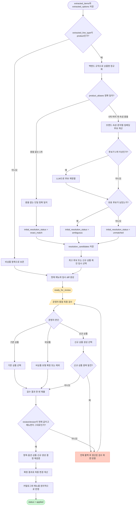

# BottleMap 메뉴 이미지 AI 추출과 상품 매칭 흐름

## 1 문서 목적

이 문서는 BottleMap에서 운영자가 메뉴판 사진을 업로드한 뒤 AI가 메뉴 정보를 추출하고, 기존 브랜드 및 상품과 매칭하거나 신규 브랜드와 상품을 등록하는 전체 흐름을 설명한다. 프론트엔드, 백엔드, AI 사이의 요청과 응답을 먼저 정의하고, 각 단계에서 현재 DBML의 어떤 테이블과 필드가 생성되거나 갱신되는지 연결한다.

프론트엔드와 백엔드 사이의 구체적인 HTTP 계약은 [frontend_backend_api_spec.md](frontend_backend_api_spec.md)에 별도로 정의한다.

이 문서의 핵심 원칙은 다음과 같다.

- 프론트엔드는 사진 업로드와 운영자 검수를 담당한다.
- 백엔드는 작업 상태, DB 저장, 정규화, 후보 생성, 검증과 최종 반영을 담당한다.
- AI는 이미지 정보 추출과 애매한 후보의 재정렬을 지원하지만 DB를 직접 읽거나 수정하지 않는다.
- AI 결과만으로 상품을 자동 생성하거나 현재 메뉴판에 게시하지 않는다.
- 기존 상품 연결과 신규 상품 생성은 운영자 검수 후 확정한다.
- `normalized_alias`는 프론트엔드나 AI가 아니라 백엔드의 공통 정규화 함수가 생성한다.

전체 흐름은 다음과 같다.

```text
프론트엔드
  → 메뉴 등록 작업 생성 및 사진 업로드
백엔드
  → 이미지 보관 및 AI 실행 작업 생성
AI
  → 상품명 가격 용량 등 구조화 결과 반환
백엔드
  → extracted_items와 options 저장 및 기존 상품 후보 검색
필요한 경우 AI
  → 복수의 기존 상품 후보 비교 및 재정렬
백엔드
  → 신규 상품 제안 및 임시 diff 생성
프론트엔드
  → 항목 역할, 상품 연결, 가격·용량 옵션, 신규 등록 제안, 임시 diff를 한 화면에서 통합 검수
백엔드
  → 최종 요청을 재검증하고 diff를 다시 계산
  → brands products aliases와 현재 메뉴판을 하나의 트랜잭션으로 반영
```

이 문서의 API 경로와 JSON 형식은 현재 논리 스키마를 구현하기 위한 권장 예시이며 확정 API 명세는 아니다.

## 2 구성 요소별 책임

### 2.1 프론트엔드

프론트엔드는 다음 작업을 담당한다.

- 업장 선택
- `full_replace` 또는 `partial_update` 선택
- 메뉴판 사진 여러 장 업로드
- AI 처리 상태 표시
- 이미지별 추출 결과 표시
- 상품 후보와 매칭 점수 표시
- 추출 상품명 가격 용량 수정
- 기존 상품 검색 및 선택
- 신규 브랜드 및 상품 등록 요청
- 현재 메뉴판과 새 결과의 diff 확인
- 변경별 적용 또는 무시 결정
- 위 결정을 한 화면에서 검수하고 한 번의 최종 요청으로 제출

### 2.2 백엔드

백엔드는 다음 작업을 담당한다.

- 사용자 인증 및 권한 확인: `users.user_type = operator`이거나 해당 업장의 현재 업주(`bar_owners`)
- `menu_imports`와 `menu_images` 생성
- 원본 이미지의 객체 저장소 보관
- AI 실행 작업 큐 관리
- AI 요청 생성 및 응답 검증
- `extraction_runs`, `extracted_items`, `extracted_options` 저장
- 상품명 및 별칭 정규화
- 브랜드 및 상품 후보 검색
- 임베딩과 LLM을 이용한 후보 재정렬
- `resolution_candidates` 저장
- 운영자 검수 결과 저장
- 신규 `brands`, `brand_aliases`, `products`, `product_aliases` 생성
- 현재 메뉴판과의 임시 `menu_import_changes` 생성
- 통합 검수 제출 시 diff 재계산과 확정된 변경의 원자적 반영

### 2.3 AI

AI는 다음 역할만 수행한다.

1. 메뉴 이미지에서 상품명 가격 용량 에디션 연수 도수 등의 후보를 추출한다.
2. 백엔드 규칙만으로 구분하기 어려운 기존 상품 후보를 재정렬한다.

## 3 단일 메뉴 등록 요청과 비동기 AI 시작

프론트엔드는 메뉴 등록 정보와 이미지들을 한 번의 요청으로 전송한다. 백엔드는 같은 요청 안에서 원본 이미지 저장, menu_imports 및 menu_images 생성, extraction_runs 생성과 AI 작업 예약까지 수행한다.

AI 결과가 나올 때까지 HTTP 연결을 유지하지는 않는다. 백엔드는 작업을 예약한 직후 202 Accepted와 menuImportId를 반환하고, AI 처리는 별도 워커가 비동기로 진행한다.

~~~text
프론트엔드의 한 번의 요청
→ 요청/이미지 검증
→ 객체 저장소 업로드
→ menu_imports 생성
→ menu_images 생성
→ extraction_runs 생성
→ AI 작업 큐 등록
→ 202 Accepted 응답
→ 비동기 AI 처리
→ 프론트엔드가 백엔드에 작업 상태 조회
~~~

### 3.1 프론트엔드 단일 요청

~~~http
POST /api/bars/{barId}/menu-imports
Authorization: Bearer <access-token>
Idempotency-Key: <고유 요청 키>
Content-Type: multipart/form-data
~~~

~~~text
mode       = full_replace
ownerNote  = 2026년 9월 메뉴판
images[]   = menu-page-1.jpg
images[]   = menu-page-2.jpg
~~~

백엔드는 먼저 로그인 사용자가 operator이거나 해당 업장의 현재 업주인지 확인한다.

업로드 제한은 다음과 같다.

~~~text
허용 형식       JPEG PNG
사진 최대 개수  15장
사진당 최대 크기 10MB
전체 최대 크기  60MB
~~~

파일 형식은 확장자가 아니라 파일 내용으로 판별하며, 선언한 MIME 형식과 다르면 거절한다(`415 UNSUPPORTED_IMAGE_TYPE`). AI 추출 모듈이 JPEG와 PNG만 모델에 보내므로 HEIC 같은 다른 형식은 받지 않는다. 안드로이드 앱은 다른 형식의 사진을 JPEG로 바꿔 올린다.

### 3.1.1 업주 신청 승인으로 시작하는 작업

업주 신청에 메뉴판 사진이 첨부되어 있으면(API 명세 3.11.15), 운영자가 신청을 승인할 때 백엔드가 그 사진으로 메뉴 등록 작업을 직접 만든다(API 명세 3.11.7). 프론트엔드의 업로드 요청은 없다.

- 사진은 이미 객체 저장소에 있으므로 3.2의 요청 검증과 3.3의 업로드를 건너뛰고, 3.4부터 같은 방식으로 `menu_imports`, `menu_images`, `extraction_runs`를 만든다. `menu_images`는 신청 사진의 저장소 key를 그대로 가리킨다.
- `mode`는 업장에 현재 메뉴판이 없으면 `full_replace`, 있으면 `partial_update`다. `ownerNote`는 `null`이다.
- 업장에 미완료 작업이 이미 있으면 작업을 만들지 않는다.
- 승인 트랜잭션을 커밋한 뒤 3.5와 같이 AI 처리를 시작한다. 이후 추출, 매칭, 검수와 반영은 업로드로 만든 작업과 같다. AI 결과만으로 게시하지 않는 원칙도 같다.

### 3.2 백엔드 요청 검증

백엔드는 파일을 저장하기 전에 다음을 검사한다.

- barId에 해당하는 활성 업장이 존재하는지
- mode가 full_replace 또는 partial_update인지
- 이미지 개수와 전체 크기가 제한 범위인지
- MIME type과 실제 파일 형식이 일치하는지(파일 앞부분의 서명으로 JPEG·PNG를 판별)
- image_order를 1부터 중복 없이 부여할 수 있는지
- 같은 Idempotency-Key로 이미 처리한 요청이 있는지
- 같은 업장에 이미 진행 중인 menu_import가 있는지

업로드 단계에서는 파일 전체를 디코딩하지 않는다. 앞부분은 정상이지만 뒤가 손상된 파일은 업로드에 성공한 뒤 추출 단계에서 이미지를 열 때 실패하며, 등록 작업은 `failed`(`IMAGE_EXTRACTION_FAILED`)가 된다. 안드로이드 앱은 필요하면 사진을 다시 인코딩해 올리므로 이런 경우는 드물다.

Idempotency-Key는 모바일 네트워크 재시도 때문에 동일 메뉴 등록 작업과 AI 비용이 중복 생성되는 것을 막기 위한 값이다. 백엔드는 이 값을 `menu_imports.idempotency_key`에 저장하고, 요청 내용은 다음과 같이 SHA-256 fingerprint로 계산해 `request_fingerprint`에 저장한다.

~~~text
canonical request
- barId
- mode
- ownerNote
- 이미지 순서
- 순서별 이미지 원본 바이트의 SHA-256

request_fingerprint = SHA-256(canonical request)
~~~

canonical request는 필드 순서와 null 표현 등을 백엔드의 한 함수로 고정한다. multipart boundary, 임시 URL, 업로드 시각, 전송 단위처럼 같은 요청의 재시도에서도 달라질 수 있는 값은 포함하지 않는다.

같은 키의 재요청에서는 새 요청의 fingerprint를 기존 행과 비교한다.

~~~text
같은 idempotency_key + 같은 request_fingerprint
→ 정상 재시도: 새 DB 행과 AI 작업을 만들지 않고 기존 menu_import 반환

같은 idempotency_key + 다른 request_fingerprint
→ 잘못된 키 재사용: 409 Conflict

다른 idempotency_key + 같은 request_fingerprint
→ 별개의 명시적 등록 요청으로 허용
~~~

`request_fingerprint` 자체에는 UNIQUE 제약을 두지 않는다.

MVP에서는 업장마다 `uploaded`, `processing`, `ready_for_review` 상태의 작업을 하나만 허용한다. 새 작업 생성 시 `bars` 또는 현재 `menu_boards` 행을 잠그고 진행 중인 작업을 다시 조회하며, 이미 있으면 새 작업 대신 기존 작업을 계속하도록 응답한다. 기존 작업을 끝내지 않고 새로 올리려면 그 작업을 취소한다(`canceled`, API 명세 5.7). 취소는 메뉴판과 카탈로그를 바꾸지 않으며, 처리 중에 취소된 작업의 AI 처리 결과는 저장하지 않는다.

### 3.3 객체 저장소 업로드

백엔드는 menuImportId로 사용할 UUID를 먼저 메모리에서 생성하고 해당 값을 포함한 storage key를 만든다.

~~~text
menus/{barId}/{menuImportId}/page-1.jpg
menus/{barId}/{menuImportId}/page-2.jpg
~~~

이미지를 객체 저장소에 업로드한다.

DB와 객체 저장소는 하나의 ACID 트랜잭션으로 묶을 수 없다. 따라서 일부 이미지 업로드가 실패하면 이미 업로드된 객체를 삭제하는 보상 처리가 필요하다.

~~~text
첫 번째 이미지 업로드 성공
→ 두 번째 이미지 업로드 실패
→ 첫 번째 이미지 객체 삭제
→ DB 레코드 생성 없이 오류 응답
~~~

### 3.4 DB 저장과 AI 실행 레코드 생성

모든 이미지가 저장되면 DB 트랜잭션에서 menu_imports, menu_images, extraction_runs를 함께 생성한다.

OCR+LLM과 Vision LLM 중 사용할 방식은 구현 전에 하나로 결정한다. MVP에서는 각 `menu_images` 행에 `extraction_runs`를 하나만 만든다. 모델 호출은 한 번의 추출 호출 안에서 재시도한다. 연결 오류와 HTTP 429·5xx는 5, 10, 20, 40, 60초 간격으로 최대 `EXTRACTION_MAX_ATTEMPTS`(기본 6)번까지 시도한다. 그래도 실패하면 그 실행 행은 `failed`로 끝나고 오류 내용은 `raw_output`에 남으며, 남은 이미지는 처리하지 않고 등록 작업 전체가 `failed`가 된다. 실패한 작업은 이어서 처리하지 않고 운영자가 새로 업로드한다. 실패한 작업을 다시 시도하는 기능은 Iteration 2 이후 필요하면 검토한다.

menu_imports 예시:

~~~text
id                = import-001
idempotency_key   = 요청 헤더의 고유 키
request_fingerprint = canonical request의 SHA-256 16진수 문자열
bar_id            = 요청한 업장 ID
mode              = full_replace
status            = uploaded
review_version    = 0
owner_note        = 2026년 9월 메뉴판
review_confirmed_at = null
created_at        = 현재 시각
completed_at      = null
~~~

full_replace는 검수된 새 결과를 전체 메뉴로 간주하여 누락된 기존 항목도 제거 후보로 만든다. partial_update는 사진에 포함된 항목만 추가하거나 수정하고 나머지는 유지한다.

menu_images 예시:

~~~text
첫 번째 이미지
- id                = image-001
- menu_import_id    = import-001
- storage_key       = menus/bar-001/import-001/page-1.jpg
- original_filename = menu-page-1.jpg
- image_order       = 1
- uploaded_at       = 현재 시각

두 번째 이미지
- id                = image-002
- menu_import_id    = import-001
- storage_key       = menus/bar-001/import-001/page-2.jpg
- original_filename = menu-page-2.jpg
- image_order       = 2
- uploaded_at       = 현재 시각
~~~

각 이미지에 대해 extraction_runs를 생성한다. 모델명과 프롬프트 버전은 백엔드 설정으로 결정한다.

~~~text
첫 번째 실행
- id               = run-001
- menu_image_id    = image-001
- approach         = vision_llm
- provider         = AI 제공자
- model_name       = 실제 모델명
- pipeline_version = bottlemap-menu-v1
- status           = queued
- raw_output       = null
- started_at       = null
- completed_at     = null
- created_at       = 현재 시각

두 번째 실행
- id               = run-002
- menu_image_id    = image-002
- approach         = vision_llm
- provider         = AI 제공자
- model_name       = 실제 모델명
- pipeline_version = bottlemap-menu-v1
- status           = queued
- raw_output       = null
- started_at       = null
- completed_at     = null
- created_at       = 현재 시각
~~~

DB 트랜잭션이 실패하면 객체 저장소에 업로드한 이미지들을 보상 삭제한다.

### 3.5 AI 작업 큐 등록

DB 트랜잭션이 커밋된 후 각 extractionRunId를 작업 큐에 넣는다.

~~~json
{
  "extractionRunId": "run-001"
}
~~~

~~~json
{
  "extractionRunId": "run-002"
}
~~~

작업 큐 등록이 모두 성공하면 menu_imports.status를 processing으로 변경한다.

작업 큐 등록이 실패하더라도 원본 이미지와 DB 데이터를 삭제하지 않는다. 다음 상태로 남긴 후 백그라운드 재시도나 수동 재실행을 지원한다.

~~~text
menu_imports.status    = uploaded
extraction_runs.status = queued
~~~

작업이 DB 커밋 전에 소비되는 문제를 막기 위해 반드시 DB 커밋 후 큐에 넣어야 한다. 신뢰성이 더 필요하면 outbox 패턴을 검토할 수 있다.

### 3.6 프론트엔드 응답

AI 결과를 기다리지 않고 작업 예약 직후 응답한다.

~~~http
HTTP/1.1 202 Accepted
Location: /api/menu-imports/import-001
Retry-After: 3
~~~

~~~json
{
  "menuImportId": "import-001",
  "status": "processing",
  "imageCount": 2,
  "statusUrl": "/api/menu-imports/import-001",
  "pollAfterMs": 3000
}
~~~

프론트엔드는 실행 행(`extraction_runs`)의 ID를 쓰지 않는다. `statusUrl` 하나로 진행률과 결과를 모두 조회하며, 조회 간격은 서버가 준 `pollAfterMs`를 따른다. 응답 형식은 API 명세 4.2를 기준으로 한다.

프론트엔드 관점에서는 메뉴 등록 버튼을 누르는 한 번의 동작으로 사진 저장과 AI 작업 시작이 모두 완료된다.

### 3.7 비동기 AI 워커 실행

AI 워커는 큐에서 extractionRunId를 가져와 DB에서 extraction_runs와 연결된 menu_images.storage_key를 조회한다.

~~~text
queued
→ running
→ 객체 저장소에서 이미지 조회
→ AI 요청
→ AI 응답 검증
→ raw_output 저장
→ extracted_items와 extracted_options 생성
→ succeeded
~~~

작업 시작 시 다음 값을 갱신한다.

~~~text
extraction_runs.status     = running
extraction_runs.started_at = 현재 시각
~~~

성공 시:

~~~text
extraction_runs.status       = succeeded
extraction_runs.raw_output   = AI 원본 응답
extraction_runs.completed_at = 현재 시각
~~~

실패 시:

~~~text
extraction_runs.status       = failed
extraction_runs.raw_output   = 오류 또는 부분 응답
extraction_runs.completed_at = 현재 시각
~~~

모든 이미지의 실행, 항목 역할 분류, 상품 후보 생성과 임시 diff 생성이 성공하면 `menu_imports.status`를 `ready_for_review`로 변경한다.

#### 3.7.1 서버 재시작 뒤 이어서 처리

현재 AI 처리는 API 프로세스 안의 백그라운드 작업이라, 배포나 장애로 프로세스가 다시 시작되면 처리가 끊긴다. 서버는 시작할 때 요청을 받기 전에 `uploaded` 또는 `processing` 상태로 남은 작업을 찾아, 별도 스레드에서 오래된 작업부터 이어서 처리한다. API 프로세스는 하나라는 전제이므로, 시작 시점에 남아 있는 미완료 작업은 모두 끊긴 작업이다.

끊긴 작업을 이어서 처리해도 안전한 이유는 다음과 같다.

- 사진 한 장의 `extracted_items`와 `extracted_options`는 그 실행이 `succeeded`가 되는 커밋에 함께 저장된다. 끊긴 순간 `running`이던 실행에는 저장된 항목이 없으므로 `queued`로 되돌려 다시 추출하고, 이미 `succeeded`인 사진은 다시 추출하지 않는다.
- 상품 후보, 임시 diff와 `ready_for_review`는 마지막에 한 번에 커밋된다. 매칭 도중 끊기면 아무것도 저장되지 않았으므로 매칭부터 다시 한다.

이어서 처리할 때마다 `menu_imports.recovery_count`를 1 올린다. 특정 사진이 프로세스를 죽여 재시작이 반복되는 것을 막기 위해, 이미 3번 이어서 처리한 작업은 다시 처리하지 않고 `failed`로 바꾼다. 이때 `running`으로 끊긴 실행이 있으면 그 실행을 `failed`로 바꾸므로 API는 `IMAGE_EXTRACTION_FAILED`를 반환하고, 없으면 `PROCESSING_FAILED`를 반환한다(API 명세 5.3).

#### 3.7.2 처리 중 취소

처리 중인 작업을 취소하면(API 명세 5.7) 취소 요청과 백그라운드 처리가 같은 `menu_imports` 행을 잠근다. 백그라운드 처리는 커밋하기 전마다(사진 추출 시작, 사진 한 장의 결과 저장, 후보와 임시 diff 저장) 행을 잠그고 아직 `processing`인지 확인하며, 아니면 저장하지 않고 끝난다.

- 이미 `succeeded`인 사진의 추출 결과는 그대로 남는다.
- 취소 시점에 추출 중이던 사진의 실행은 취소 요청이 `failed`로 끝내고 `raw_output`에 취소를 기록한다. 그 사진의 추출 결과와 오류는 저장하지 않는다. 취소 뒤 서버가 재시작돼도 `running`으로 남지 않는다.
- 아직 시작하지 않은 사진의 실행은 `queued`로 남는다.
- 매칭 도중 취소되면 후보와 임시 diff는 롤백되어 저장되지 않는다.
- `canceled`는 미완료 상태가 아니므로 서버 재시작 뒤 이어서 처리하지 않는다(3.7.1).

### 3.8 프론트엔드 상태 조회

프론트엔드는 응답받은 `statusUrl`로 처리 상태를 조회한다. 조회 간격은 서버가 응답에 담아 주는 `pollAfterMs`(현재 3초)를 따른다. 응답 형식은 API 명세 5장을 기준으로 한다.

~~~http
GET /api/menu-imports/import-001
~~~

처리 중 응답:

~~~json
{
  "menuImportId": "import-001",
  "status": "processing",
  "progress": {
    "totalImages": 2,
    "completedImages": 1,
    "failedImages": 0
  },
  "pollAfterMs": 3000
}
~~~

처리가 끝나 `ready_for_review`가 되면 같은 조회가 통합 검수 데이터 전체(이미지, 추출 항목과 옵션, 후보, 변경 제안)를 바로 반환한다. 형식은 14장과 API 명세 5.4를 따른다. 실패하면 `status = failed`와 `failure`를 반환한다(API 명세 5.3).

추후 필요하면 polling 대신 Server-Sent Events를 사용할 수 있다. 현재 흐름에는 양방향 실시간 통신이 필요하지 않으므로 WebSocket까지 사용할 필요는 없다.


## 4 AI 이미지 추출 요청과 응답

### 4.1 OCR LLM 방식

`approach = ocr_llm`이면 다음 순서로 처리한다.

```text
원본 이미지
→ OCR 텍스트와 위치 추출
→ 백엔드가 위치를 기준으로 단어를 라인 단위로 묶음
→ LLM이 라인 역할을 1차 분류하고 상품 정보를 구조화
→ 역할과 옵션이 표시된 전체 항목 JSON
```

OCR 응답 예시:

```json
{
  "words": [
    {
      "text": "딘스톤",
      "confidence": 0.97,
      "boundingBox": [120, 340, 280, 385]
    },
    {
      "text": "12년",
      "confidence": 0.95,
      "boundingBox": [290, 340, 370, 385]
    },
    {
      "text": "15ml",
      "confidence": 0.94,
      "boundingBox": [460, 340, 530, 385]
    },
    {
      "text": "8.0",
      "confidence": 0.89,
      "boundingBox": [550, 340, 610, 385]
    }
  ]
}
```

백엔드는 OCR 텍스트와 위치를 줄 단위로 정리한 후 LLM에 구조화를 요청한다.

```json
{
  "task": "Extract whisky menu items without inventing missing values.",
  "currency": "KRW",
  "ocrLines": [
    {
      "text": "딘스톤 12년 15ml 8.0 / 30ml 15.0",
      "page": 1,
      "line": 7
    }
  ],
  "rules": [
    "Do not invent values not visible in the menu.",
    "Return null when a value is uncertain.",
    "Preserve the relation between pour size and price.",
    "Do not treat section titles as products."
  ]
}
```

### 4.2 Vision LLM 방식

`approach = vision_llm`이면 이미지와 동일한 구조화 규칙을 모델에 직접 전달한다.

```text
원본 이미지
→ Vision LLM
→ 라인 역할 1차 분류와 상품 정보 구조화
→ 역할과 옵션이 표시된 전체 항목 JSON
```

### 4.3 권장 AI 응답 형식

OCR LLM과 Vision LLM의 최종 응답 형식은 동일하게 맞추는 것이 좋다.

OCR LLM과 Vision LLM은 메뉴에서 인식한 모든 상품 또는 비상품 블록을 `product`, `section_header`, `description`, `unknown` 중 하나로 1차 분류하고 `items`에 반환한다. 실제 상품인지에 대한 1차 판별은 상품 매칭을 시작하는 6장보다 앞선 AI 추출 단계에서 수행되지만, 비상품 블록도 누락하지 않고 함께 반환한다.

이 판단은 최종 확정이 아니다. AI가 헤더나 설명을 `product`로 잘못 분류하거나 실제 상품을 다른 유형으로 분류할 수 있으므로 운영자 검수가 끝날 때까지 `lineType`은 1차 분류로만 취급한다.

```json
{
  "items": [
    {
      "itemOrder": 6,
      "rawText": "싱글 몰트",
      "lineType": "section_header",
      "productName": null,
      "brandText": null,
      "ageYears": null,
      "editionName": null,
      "abv": null,
      "options": [],
      "confidence": 0.98
    },
    {
      "itemOrder": 7,
      "rawText": "딘스톤 12년 15ml 8.0 / 30ml 15.0",
      "lineType": "product",
      "productName": "딘스톤 12년",
      "brandText": "딘스톤",
      "ageYears": 12,
      "editionName": null,
      "abv": null,
      "options": [
        {
          "optionLabel": null,
          "pourMl": 15,
          "priceKrw": 8000
        },
        {
          "optionLabel": null,
          "pourMl": 30,
          "priceKrw": 15000
        }
      ],
      "confidence": 0.92
    }
  ]
}
```

백엔드는 JSON 스키마, `lineType` Enum, 길이, 숫자 범위, 가격과 용량의 대응 관계를 검증한다. 이 검증은 형식 검증이며 문구가 실제 상품인지 의미적으로 최종 확정하는 단계는 아니다. 성공하면 전체 응답을 `extraction_runs.raw_output`에 저장하고 `status = succeeded`로 변경한다. 실패하면 `status = failed`와 오류 또는 부분 응답을 기록한다.

### 4.4 현재 구현 상태 (Gemini prompt v1)

4.3의 형식은 백엔드가 받는 공통 형식이며, 개발용 mock 추출기는 이 형식을 모두 채운다. 실제 Gemini 추출은 P14에서 평가한 prompt v1(`backend/app/extraction/prompt_v1.md`)을 그대로 사용하며, 모델은 위스키 한 줄의 가격 단위마다 다음 네 필드만 반환한다.

```json
{ "raw_name": "딘스톤 12년", "price_krw": 8000, "pour_ml": 15, "unit": "glass" }
```

- 섹션 제목, 열 제목, 설명, 세트 메뉴, 비위스키 섹션(칵테일·와인·맥주·음식 등)은 프롬프트가 반환하지 않게 한다.
- 한 줄에 잔·병 가격이 모두 있으면 두 항목으로 나눠 반환한다. 어댑터(`backend/app/extraction/convert.py`)는 이름이 같은 인접한 잔·병 항목을 옵션 두 개(`잔`, `병`)를 가진 한 항목으로 묶어 4.3 형식으로 바꾼다.
- 따라서 현재 모든 항목의 `lineType`은 `product`이고, `brandText`, `ageYears`, `editionName`, `abv`, `confidence`는 항상 `null`이다. 이름에 적힌 연수(예: `12년`)는 7장 정규화로 별칭 조회 키에 반영되지만, 10장의 연수·에디션 비교는 추출값이 없어 동작하지 않는다.
- 4.3 형식 전체를 채우는 prompt v2는 후속 과제다. v1과 결과가 달라지므로 새 평가 실행으로 정확도를 확인한 뒤 v1을 대체한다.

## 5 extracted_items와 extracted_options 저장

백엔드는 4.3 응답의 `items`를 각각 하나의 `extracted_items` 행으로 저장한다. `extracted_line_type`에는 AI의 1차 분류를 넣고 `corrected_line_type = null`, `review_status = pending`으로 저장한다. `section_header`, `description`, `unknown`도 원문과 함께 보존하지만 `extracted_line_type = product`인 항목만 최초 상품 매칭 단계로 보낸다.

섹션 제목은 옵션 없이 항목만 저장한다.

```text
extracted_items
- id                       = item-006
- extraction_run_id        = run-001
- item_order               = 6
- raw_text                 = 싱글 몰트
- extracted_line_type      = section_header
- corrected_line_type      = null
- extracted_product_name   = null
- extraction_confidence    = 0.9800
- review_status            = pending
```

상품명과 상품 매칭에 필요한 값은 `extracted_items`에 한 번만 저장한다.

```text
extracted_items
- id                       = item-007
- extraction_run_id        = run-001
- item_order               = 7
- raw_text                 = 딘스톤 12년 15ml 8.0 / 30ml 15.0
- extracted_line_type      = product
- corrected_line_type      = null
- extracted_product_name   = 딘스톤 12년
- extracted_brand_name     = 딘스톤
- extracted_age_years      = 12
- extracted_edition_name   = null
- extracted_abv            = null
- extraction_confidence    = 0.9200
- selected_product_id      = null
- selected_match_method    = null
- match_confidence         = null
- review_status            = pending
- corrected_product_name   = null
- reviewed_at              = null
```

가격과 용량은 같은 부모 항목을 참조하는 `extracted_options`로 분리한다.

```text
extracted_options #1
- id                       = option-001
- extracted_item_id        = item-007
- option_order             = 1
- extracted_option_label   = null
- extracted_price_krw      = 8000
- extracted_pour_ml        = 15
- corrected_option_label   = null
- corrected_price_krw      = null
- corrected_pour_ml        = null

extracted_options #2
- id                       = option-002
- extracted_item_id        = item-007
- option_order             = 2
- extracted_option_label   = null
- extracted_price_krw      = 15000
- extracted_pour_ml        = 30
- corrected_option_label   = null
- corrected_price_krw      = null
- corrected_pour_ml        = null
```

하나의 AI 상품 항목이 여러 옵션을 가져도 상품명, 항목 역할, 상품 후보와 검수 상태를 중복 저장하지 않는다. 최종 게시 시 `extracted_items` 하나는 `menu_board_entries` 하나로, 각 `extracted_options`는 `menu_entry_options`로 자연스럽게 대응한다.

운영자는 AI가 실제 상품을 `section_header`, `description`, `unknown`으로 잘못 분류했다면 `corrected_line_type = product`로 교정하고 직접 기존 상품을 선택하거나 새 상품을 등록한다. 상품으로 잘못 분류한 항목은 올바른 비상품 유형을 `corrected_line_type`에 저장한다. OCR 잡음이나 중복처럼 사용할 수 없는 항목만 `review_status = rejected`로 제외한다. `extracted_line_type`은 AI의 최초 분류로 유지되며, 실제 처리 역할은 `COALESCE(corrected_line_type, extracted_line_type)`이다.

## 6 자동 처리 및 통합 최종 검수 순서 요약

이 절은 모든 `extracted_items`의 역할을 검수하고, 그중 AI가 `extracted_line_type = product`로 분류한 항목에 최초 상품 매칭을 수행하는 과정을 한눈에 보기 위한 요약이다. 운영자는 최초 역할과 상품 매칭 결과를 모두 최종 판단한다. 각 단계의 상세 규칙과 저장 필드는 7장부터 18장까지 설명한다.

> **현재 구현 (I2-A18, I2-A22):** 백엔드는 아래 정확 일치(8장) 다음에 단계 규칙 S1(이름 변형), S2(브랜드+연수·에디션), S2b(기본 상품), S3(숫자가 있는 이름의 1글자 오타)를 실행한다(`backend/app/matching/staged.py`). 11장의 점수 계산과 12장의 LLM 재정렬은 서버에 없고, 그 대신 아래 LLM 매칭 층이 있다. 따라서 `exact_match`는 정확 별칭 일치뿐 아니라 이 규칙들이 상품 하나를 확정한 경우에도 나오며, 어느 규칙인지는 후보 `evidence.rule`(`alias`, `S1`, `S2`, `S2b`, `S3`)로 구분한다. 한 줄에 다른 브랜드의 두 상품이 있으면(S1) 두 상품을 후보로 남긴 `ambiguous`로 저장한다.
>
> **LLM 매칭 층 (I3, 기본 꺼짐):** `MATCHING_LLM_ENABLED=true`(와 `GEMINI_API_KEY`)이면 S1~S3가 확정하지 못한 줄에 I2 평가에서 채택한 M3a를 합치기 방식으로 실행한다(`backend/app/matching/llm_layer.py`, `ai/match_llm/m3.py`와 같은 규칙·프롬프트·모델 `gemini-3.1-flash-lite`). 사진마다 한 번 LLM이 대상 줄을 영문(병입사·증류소·브랜드, 연수, 에디션 토큰)으로 풀어 쓰면, 그 이름으로 S1~S3를 다시 돌리고 표준명 핵심 토큰이 모두 맞는 상품도 찾는다. 후보마다 거부권(`bottler_missing`, `age_mismatch`, `alias_of_other`, `edition_mismatch`)을 검사해 걸리면 버린다. 남은 LLM 후보는 `method = llm`, `evidence.rule = M3a`로 S1~S3 후보 앞에 두고 그 줄은 항상 `ambiguous`다. 자동 확정·게시는 하지 않는다. LLM 후보가 하나이고 S1~S3 후보가 없었거나 그 안에 있을 때만 `evidence.confirmRecommended`를 붙여 업주가 한 번에 확인하게 한다(P29). LLM 호출 실패·시간 초과·형식이 틀린 응답·키 없음, 또는 등록 작업당 호출 상한(`MATCHING_LLM_MAX_CALLS`, 기본 30) 초과면 그 줄은 S1~S3 결과 그대로이고 등록 작업은 실패하지 않는다. M3b(브랜드 상품 목록에서 LLM이 고르기)는 평가에서 채택하지 않아 `MATCHING_LLM_M3B_ENABLED=true`일 때만 실행한다.

> **안전 규칙과 위스키 용어 사전 (I3-A4):** (1) S3는 숫자 앞 이름(앞의 `더`/`The`와 문장부호 제외)이 3음절 이하 한글일 때 1음절 차이로 확정하지 않고 후보도 내지 않는다(`달모어 18` ≠ `보모어 18`, `더 달무어 18`, `아드백-10`). (2) S2가 에디션 토큰으로 상품 하나를 골랐어도 그 상품의 `edition_name`에 줄에 없는 단어가 있으면(cask·oak·finish 같은 중립어 제외) 확정하지 않고 그 상품 하나를 확인 권장(`confirmRecommended`)으로 남기며, 빠진 단어를 evidence `editionOnlyInProduct`에 적는다(`anCnoc Sherry` → anCnoc Peated Sherry Cask). 줄에 사전이 모르는 한글 단어가 있으면(`비노 바리끄`) 사전에 있는 영어 단어만 빠진 것으로 센다. 줄에 연수가 아닌 숫자(연도, `#2`, `16.2`. 도수·용량·잔·가격 표기인 `46%`, `700 ml`, `16,000원`은 제외)가 있으면, 이름에 숫자가 있는데 줄의 숫자가 하나도 없는 상품은 후보에서 뺀다(`클래식컷 2025` ≠ Classic Cut 2020). (3) 줄에 다시 쓴 브랜드명(`Aberlour 12 (아벨라워)`, `(컴파스 박스)`처럼 두 토큰에 걸쳐도)은 에디션 토큰이 아니고, 브랜드명뿐인 이름 변형은 다른 이름이 아무것도 못 찾을 때만 쓴다. 연수가 없을 때 확인할 수 없는 짧은 영문자 토큰(`DR`)은 상품을 지우지 않는다(숫자는 지운다). (4) S1–S3가 확정하지 못한 줄은 `backend/app/matching/vocab_ko_en.json`의 한글 위스키 용어를 영어로 바꿔(셰리 캐스크 → sherry cask, 더블우드 → double wood) 한 번 더 찾고, 확정되거나, 후보가 없던 줄에 후보가 생기고 1순위 후보에 맞는 에디션 토큰이 있을 때만(브랜드+연수만 맞는 목록은 버림) 그 결과를 쓴다. 이때 후보 evidence `vocabulary`에 바꾼 이름이 들어가고 `rule`은 그 후보를 찾은 단계 그대로다. 사전의 영어 단어는 카탈로그 에디션·표준명에서만 골랐고, 한글 표기를 만든 경위와 한계는 파일의 `about`에 있다.

```text
for each extracted_item:
    if extracted_line_type != product:
        candidates = []
        initial_resolution_status = null  # 상품 매칭을 실행하지 않음
        continue

    normalized_name = normalize(extracted_product_name)                 # [7장]

    exact_matches = product_aliases에서 normalized_name 정확 조회       # [8장]

    if exact_matches가 1개이고 추출 속성과 충돌 없음:
        candidates = exact_matches # 원소 1개의 목록
        initial_resolution_status = exact_match

    else:
        if exact_matches가 1개 이상:
            candidates = exact_matches # 단일 충돌 후보 또는 원소 여러 개의 목록
        else:
            brand = brand_aliases로 브랜드 판별                          # [9장]

            if brand를 찾음:
                candidates = 해당 브랜드의 상품
            else:
                candidates = 전체 상품

        candidates의 연수·에디션 충돌을 evidence에 기록 (후보는 남김)    # [10장]
        candidates = 문자열 및 임베딩 유사도로 점수 계산                 # [11장]
        candidates = product_id 기준으로 병합하고 모든 근거를 evidence에 합침

        if candidates가 2개 이상:
            candidates = 반드시 LLM으로 후보 재정렬                       # [12장]

        if candidates가 1개 이상:
            initial_resolution_status = ambiguous
        else:
            initial_resolution_status = unmatched

    product_id당 한 행으로 resolution_candidates에 candidates 저장

각 product 항목에 대해:
    후보가 있으면 proposedProductId = candidate_rank 1의 product_id
    후보가 없으면 proposedProductId = null이고 신규 상품 제안 생성
각 extracted_item과 하위 extracted_options로 게시 구조 초안 생성       # [13장]
현재 메뉴와 비교해 menu_import_changes 초안 생성                        # [13장]
menu_imports.review_version 증가
menu_imports.status = ready_for_review

프론트엔드에 다음 내용을 한 번에 반환                                   # [14장]
    전체 extracted_items, extractedLineType, correctedLineType, effectiveLineType,
    initialResolutionStatus, 하위 extracted_options
    상품별 candidates와 임시 선택
    신규 브랜드·상품 생성 제안
    추가·수정·삭제 proposedChanges

운영자가 통합 검수를 한 번 제출하면:                                    # [14장]
    SERIALIZABLE 트랜잭션 시작
    menu_import.status와 reviewVersion 검증
    menu_imports 행 잠금 (새 작업 생성 때는 bars 행을 잠금)
    if 검수 데이터를 만든 뒤 현재 메뉴판이 바뀜:
        임시 diff 재생성, reviewVersion 증가
        REVIEW_OUTDATED 반환

    for each itemDecision:
        if 운영자가 사용할 수 없는 인식 항목으로 판단:
            review_status = rejected
            continue

        if finalLineType == extracted_line_type:
            corrected_line_type = null
        else:
            corrected_line_type = finalLineType
        effective_line_type = COALESCE(corrected_line_type, extracted_line_type)

        if effective_line_type != product:
            if finalLineType이 AI의 기존 extracted_line_type과 같음:
                review_status = confirmed
            else:
                review_status = corrected
            continue

        switch 상품 처리 판단:
            case 기존 상품 선택:                                         # [15장]
                selected_product_id = 선택한 기존 상품 ID
                if selected_product_id == 현재 reviewVersion의 proposedProductId:
                    selected_match_method = 1순위 resolution_candidate.method
                else:
                    selected_match_method = manual
                if 선택한 상품이 resolution_candidates에 있음:
                    match_confidence = 해당 후보의 score
                else:
                    match_confidence = null
                필요한 경우 검증된 aliases 생성                          # [15.1장]

            case 신규 상품 생성:                                         # [16장]
                selected_match_method = manual
                match_confidence = null
                brandDecision = 운영자가 선택한 기존 brandId 또는 신규 브랜드 정보

                if brandDecision이 기존 브랜드:
                    brandId 존재 여부 검증
                else:
                    duplicate_brand = 정규화한 브랜드명과 별칭 정확 검사 # [16.1장]
                    if 동일 브랜드가 확인됨:
                        전체 트랜잭션 중단, 아무것도 만들지 않음
                        409 DUPLICATE_BRAND_FOUND (기존 브랜드 정보, reviewUrl) 반환

                duplicate_product = 신규 생성 직전 동일 상품 검사        # [16.1장]

                if 동일한 duplicate_product가 확인됨:
                    전체 트랜잭션 중단, 아무것도 만들지 않음
                    409 DUPLICATE_PRODUCT_FOUND (기존 상품 정보, reviewUrl) 반환
                else if 기존 브랜드를 선택함:
                    해당 브랜드에 product와 product_aliases 생성         # [16.2장]
                else:
                    brand와 brand_aliases 생성                            # [16.3장]
                    생성한 브랜드에 product와 product_aliases 생성        # [16.3장]

    확정 결과로 최종 변경 계산                                           # [17장]
    (운영자 결정 때문에 초안과 달라진 변경도 그대로 반영)
    review_confirmed_at 저장
    현재 메뉴판의 entries와 options에 변경을 원자적으로 반영
    menu_imports.status = applied
    트랜잭션 커밋
```



18장은 독립된 실행 단계가 아니라 위 과정에서 `brands`, `brand_aliases`, `products`, `product_aliases`, `extracted_items`, `extracted_options`의 각 필드를 누가 어떤 기준으로 결정하는지 설명하는 참조 장이다.

위 순서에서 `product_aliases`, `brand_aliases`, 문자열 유사도, 임베딩과 LLM은 각각 별개의 최종 처리 경로가 아니다. 모두 운영자가 검토할 기존 상품 후보를 만들고 순위를 정하기 위한 수단이다.

AI가 바로 상품을 확정하거나 신규 브랜드·상품을 생성하지 않는다. 백엔드는 후보와 임시 diff까지 먼저 만들고 `ready_for_review`에서 대기한다. 운영자는 한 화면에서 항목 역할, 상품 연결, 가격·용량 옵션, 신규 생성 제안과 메뉴 변경안을 함께 검수하며, 한 번의 최종 제출이 성공한 경우에만 카탈로그와 현재 메뉴판이 함께 반영된다.

## 7 문자열 정규화

정규화는 AI가 수행하지 않는다. 백엔드가 코드로 구현한 하나의 공통 정규화 함수를 사용한다. AI가 반환한 `extracted_product_name`을 검색할 때와 `brand_aliases.normalized_alias`, `product_aliases.normalized_alias`를 저장할 때 모두 같은 정규화 함수를 적용해야 한다.

예시:

```text
원문       = " 딘스톤 12年 "
정규화값   = "딘스톤12"
```

구체적인 규칙과 적용 순서는 `backend/app/core/normalize.py`가 기준이며, 입력과 기대 출력 예시는 `backend/tests/test_normalize.py`에 있다. 규칙을 바꿀 때는 이 문서가 아니라 코드와 테스트를 함께 수정한다.

### 7.1 정규화에 AI를 사용하지 않는 이유

- **결정성:** 같은 입력은 언제 실행해도 반드시 같은 정규화값을 만들어야 한다.
- **비교 일관성:** 추출 문자열과 DB 별칭이 완전히 같은 규칙으로 변환되어야 정확 일치 검색이 가능하다.
- **재현성:** 매칭 오류가 발생했을 때 어떤 규칙으로 해당 값이 생성됐는지 다시 확인할 수 있어야 한다.
- **테스트 가능성:** 입력과 예상 출력의 테스트 케이스를 만들어 정규화 결과를 자동 검증할 수 있어야 한다.
- **일괄 변경:** 별칭 행에 버전 컬럼을 두지 않는다. 규칙이 변경되면 기존 브랜드·상품 별칭의 `normalized_alias` 전체를 새 함수로 한 번에 재생성한 뒤 새 백엔드를 활성화한다.
- **비용과 속도:** 단순 문자열 변환에 모델 호출 비용과 네트워크 지연을 추가할 필요가 없다.
- **오류 방지:** LLM이 문자열을 번역하거나 의미를 추측해 원문에 없는 정보를 추가하는 것을 막을 수 있다.

따라서 AI는 상품명, 브랜드명, 연수, 에디션 같은 의미 있는 정보를 이미지에서 추출하는 역할을 맡고, 백엔드는 그 결과의 표기 형식만 고정 규칙으로 정규화한다. 규칙 정규화와 정확한 별칭 조회로 후보를 결정하기 어려울 때만 임베딩 또는 LLM을 후속 매칭 단계에서 사용한다.

정규화 함수를 변경하는 배포에서는 새 함수로 `brand_aliases.normalized_alias`와 `product_aliases.normalized_alias`를 모두 재계산하고 unique 제약 충돌 여부를 검사한다. 재계산은 `backend/scripts/renormalize_aliases.py`로 수행한다(인자 없이 실행하면 변경 예정 내역만 출력하고, `--apply`로 반영한 뒤 `seed_catalog.py`를 다시 실행). 이 재계산이 성공한 뒤에만 새 함수를 사용하는 백엔드를 활성화한다. 일부 별칭만 새 규칙으로 바꾸거나 구규칙·신규칙 검색을 동시에 운영하지 않는다.

정규화는 번역이 아니다. `Deanston`과 `딘스톤`은 각각 별칭으로 저장되고 같은 브랜드 또는 상품 ID를 가리킨다.

브랜드의 `canonical_name`과 상품의 `display_name`도 각각 기본 별칭으로 저장한다. 따라서 브랜드명은 `brand_aliases.normalized_alias`, 상품명은 `product_aliases.normalized_alias`만 검색하면 된다.

## 8 product_aliases 정확 일치

AI 추출 결과가 `딘스톤 12년`이면 백엔드는 정규화 규칙으로 `딘스톤12`를 생성한 뒤 다음을 조회한다.

정확 일치 검색에서는 `alias_text`와 `normalized_alias`를 함께 비교하지 않고 `normalized_alias` 한 컬럼만 비교한다. `normalized_alias`가 `alias_text`로부터 백엔드 정규화 함수에 의해 항상 동일하게 결정되기 때문이다.

```sql
product_aliases.normalized_alias = '딘스톤12'
```

기존 데이터 예시:

```text
products
- id           = product-deanston-12
- display_name = Deanston 12
- brand_id     = brand-deanston
- age_years    = 12
```

```text
product_aliases
- product_id       = product-deanston-12
- alias_text       = 딘스톤 12년
- normalized_alias = 딘스톤12
- language_code    = ko
- is_searchable    = true
```

한 상품만 일치하면 강한 후보로 저장한다.

```text
resolution_candidates
- extracted_item_id = 현재 추출 상품 항목 ID
- product_id         = product-deanston-12
- candidate_rank     = 1
- score              = 1.000000
- method             = alias
- evidence           = {aliasExact: true}
- created_at         = 현재 시각
```

`normalized_alias`는 전역 unique가 아니므로 같은 별칭이 여러 상품에 연결될 수 있다. 여러 상품이 조회되면 모두 후보로 저장하고 자동 확정하지 않는다.

## 9 브랜드 판별

전체 상품 별칭이 정확히 일치하지 않으면 AI가 제안한 브랜드 문자열을 이용한다.

```json
{
  "productName": "딘스톤 버진 오크",
  "brandText": "딘스톤",
  "ageYears": null,
  "editionName": "버진 오크"
}
```

`딘스톤`을 정규화해 `brand_aliases.normalized_alias`에서 조회한다.

```text
brands
- id             = brand-deanston
- canonical_name = Deanston
```

```text
brand_aliases
- brand_id         = brand-deanston
- alias_text       = 딘스톤
- normalized_alias = 딘스톤
- language_code    = ko
```

브랜드가 확인되면 `products.brand_id = brand-deanston`이고 `is_active = true`인 상품으로 후보 범위를 좁힌다. `canonical_name`도 기본 브랜드 별칭으로 저장되므로 별도의 `brands.canonical_name` 검색은 필요하지 않다.

## 10 구조화된 상품 속성 비교

### 10.1 연수

연수는 강한 충돌 조건이다.

```text
추출값 = Glenfiddich 12
후보   = Glenfiddich 15
결과   = 자동 매칭 금지
```

- 추출 연수와 후보 연수가 같으면 강한 근거로 기록한다(`ageExact`).
- 둘 중 하나가 null이면 비교하지 않으며 충돌로 보지 않는다.
- 둘 다 존재하고 값이 다르면 자동 확정하지 않는다. 후보는 지우지 않고 남기되 `ambiguous`로 두고 `ageConflict`를 기록한다. AI가 연수를 잘못 읽었을 때 운영자가 그 후보를 바로 고를 수 있게 하기 위해서다.

### 10.2 에디션

`Deanston Virgin Oak`와 `Deanston 12`는 같은 브랜드라도 다른 상품이다.

- 추출 에디션이 상품의 `edition_name`이나 그 상품의 별칭 안에 있으면 일치로 본다(`editionExact`). 카탈로그는 영어 에디션명을 쓰고 메뉴는 한글로 쓰는 경우가 있어 별칭까지 확인한다(예: Lasanta / 라산타).
- 에디션이 충돌하면 자동 확정하지 않는다. 후보는 남기되 `ambiguous`로 두고 `editionConflict`를 기록한다.
- 에디션이 추출값 쪽에만 있으면 확인할 수 없으므로 자동 확정하지 않는다(`editionOnlyInExtracted`).
- 에디션이 상품 쪽에만 있으면 충돌로 보지 않는다. 이름 전체 별칭이 정확히 일치했다면 에디션은 이미 이름 안에서 맞춰진 것이기 때문이다.

현재 에디션 전용 별칭 테이블은 없으므로 에디션의 다양한 표현은 전체 이름을 담는 `product_aliases`가 처리한다.

### 10.3 ABV

`abv`가 일치하면 보조 근거로 사용할 수 있지만 메뉴에 도수가 생략되는 경우가 많으므로 핵심 식별 키로 사용하지 않는다.

### 10.4 category

현재 기본값은 `whisky`다. 위스키 메뉴 처리 중에는 같은 카테고리의 상품을 우선 후보로 사용한다. `category`를 문자열 Enum 테이블 중 무엇으로 구현할지는 아직 미확정이다.

## 11 후보 점수 계산 및 순위 결정

8장의 별칭 조회와 9장의 브랜드 판별로 만든 후보에서 10장의 속성 충돌 검사를 통과한 상품들을 평가하고 순위를 정하는 단계다. `product_aliases.normalized_alias`가 정확히 하나의 상품과 일치하고 속성 충돌도 없을 때만 단일 후보로 처리하며, 이 계산을 생략한다.

후보마다 다음 값을 `0`부터 `1` 사이의 점수로 계산한다.

- 편집 거리 유사도: `버진옥`과 `버진오크`처럼 글자 추가·삭제·변경 횟수가 적을수록 높은 점수를 준다. OCR 오인식과 짧은 오타에 유용하다.
- 토큰 유사도: 이름을 단어 단위로 나눠 공통 단어가 얼마나 포함되는지 계산한다. 단어 순서가 다르거나 일부 단어가 추가·생략된 경우에 유용하다.
- 다국어 임베딩 유사도: 한글과 영문처럼 글자는 달라도 의미가 가까운 이름을 벡터로 비교한다. 의미가 비슷한 다른 상품에도 높은 값이 나올 수 있으므로 단독 확정 기준으로 사용하지 않는다.
- 구조화 속성 일치도: 브랜드, 연수, 에디션, 카테고리 등 AI 추출 속성과 후보 상품의 값을 비교한다. 10장에서 명백한 충돌은 이미 제거하고, 여기서는 남은 후보의 상대적 적합도를 계산한다.

각 점수에 가중치를 적용해 후보별 종합 점수를 만들고 높은 순서대로 정렬한다.

예시 가중치:

```text
브랜드 일치        0.30
연수 일치          0.25
에디션 일치        0.25
전체 이름 유사도   0.10
임베딩 유사도      0.10
```

가중치는 고정값이 아니라 평가 데이터로 조정한다. 종합 점수는 실제 동일 상품일 확률이 아니라 후보들의 상대적 순위를 정하기 위한 값이다. 동일 상품이 별칭, 속성, 문자열, 임베딩 등 여러 경로에서 발견되면 `product_id` 기준으로 하나의 후보로 병합하고 각 경로의 결과를 `evidence`에 합친다. 정확한 별칭 단일 일치가 아닌 경로에서 서로 다른 상품 후보가 2개 이상 남으면 점수 차이와 관계없이 12장의 LLM 후보 재정렬 대상으로 넘긴다. 후보별 결과는 상품당 한 행으로 `resolution_candidates`에 저장한다.

```text
rank 1
- product_id = Deanston Virgin Oak
- score      = 0.932100
- method     = embedding
- evidence   = {brandExact: true, ageExact: true, editionSimilarity: 0.94,
                nameSimilarity: 0.88, embeddingSimilarity: 0.91}

rank 2
- product_id = Deanston 12
- score      = 0.481200
- method     = embedding
- evidence   = {brandExact: true, ageExact: false, editionConflict: true,
                nameSimilarity: 0.61, embeddingSimilarity: 0.72}
```

`evidence`에는 후보 생성과 점수 계산에 실제 사용한 세부 신호를 저장한다. 모든 키를 항상 채우는 것은 아니며, 적용하지 않은 비교 항목은 생략하거나 `null`로 둔다. `method`는 신호 목록이 아니라 최종 순위를 결정한 대표 방법이다. 정확 별칭 단일 일치는 `alias`, LLM 없이 유사도 점수가 순위를 결정하면 `embedding`, LLM이 복수 후보를 재정렬하면 `llm`을 저장한다. BottleMap은 false merge를 누락보다 위험하게 취급하므로 확실하지 않으면 자동 병합하지 않는다.

## 12 LLM 후보 재정렬

> **현재 구현:** 이 장의 재정렬은 구현하지 않았다. 서버의 LLM 단계는 6장 "현재 구현"의 LLM 매칭 층(M3)이다.

`product_aliases.normalized_alias`가 정확히 하나의 상품과 일치한 경우를 제외하고, 유효 후보가 2개 이상이면 점수 차이와 관계없이 LLM을 사용한다. 백엔드는 전체 상품 DB 대신 규칙으로 좁힌 2~5개 후보만 전달한다. LLM은 후보 순위와 근거를 보조할 뿐 상품을 최종 확정하지 않으며, `판단 불가` 또는 `일치 후보 없음`도 반환할 수 있어야 한다.

```json
{
  "extracted": {
    "rawText": "딘스톤 버진오크 46.3",
    "productName": "딘스톤 버진오크",
    "brand": "딘스톤",
    "ageYears": null,
    "editionName": "버진오크",
    "abv": 46.3
  },
  "candidates": [
    {
      "productId": "product-001",
      "displayName": "Deanston Virgin Oak",
      "brand": "Deanston",
      "ageYears": null,
      "editionName": "Virgin Oak",
      "abv": 46.3
    },
    {
      "productId": "product-002",
      "displayName": "Deanston 12",
      "brand": "Deanston",
      "ageYears": 12,
      "editionName": null,
      "abv": 46.3
    }
  ],
  "rules": [
    "Do not choose a candidate with a conflicting age.",
    "Do not choose a candidate with a conflicting edition.",
    "Return null when evidence is insufficient.",
    "Return only a productId included in candidates."
  ]
}
```

LLM 응답:

```json
{
  "selectedProductId": "product-001",
  "confidence": 0.97,
  "reasonCode": "brand_edition_abv_match"
}
```

백엔드는 반환 ID가 요청 후보에 포함되는지, 상품이 활성 상태인지, 연수나 에디션 충돌이 없는지 다시 검사한다. 검증된 `confidence`와 `reasonCode`는 해당 후보의 `resolution_candidates.evidence`에 추가하고 LLM 재정렬 결과에 맞춰 순위를 갱신한다. 통과한 결과도 운영자에게 제시할 후보이며 자동 게시 결과가 아니다.

후보 재정렬용 모델과 프롬프트는 백엔드 코드 또는 배포 설정에서 버전 관리한다. 프로토타입 DB에는 호출별 모델·프롬프트·원본 응답을 별도 실행 행으로 저장하지 않고, 검수와 디버깅에 필요한 최종 순위·점수·`evidence`만 보관한다.

## 13 임시 diff 생성

백엔드는 각 상품 항목의 `resolution_candidates`에서 `candidate_rank = 1`인 상품을 `proposedProductId`로 계산하고 현재 메뉴판과의 `menu_import_changes` 초안을 만든다. `proposedProductId`는 DB 컬럼이 아니라 임시 diff와 통합 검수 응답에서만 사용하는 계산값이다. 이 시점에는 `extracted_items.selected_product_id`를 저장하거나 신규 카탈로그와 고객용 메뉴를 변경하지 않는다.

비교 대상은 두 묶음이다.

```text
새 메뉴 초안
- product 항목의 임시 상품 후보
- 하위 extracted_options의 가격과 용량

현재 게시 메뉴
- 현재 menu_board의 menu_board_entries
- 각 항목이 가리키는 bar_menu_items와 products
- 하위 menu_entry_options의 가격과 용량
```

백엔드는 상품 ID와 옵션 구성을 기준으로 변경 유형을 나눈다.

- `add`: 새 메뉴 초안에는 있지만 현재 메뉴판에는 없는 상품이다.
- `update`: 같은 상품이 현재 메뉴판에도 있지만 가격·용량·옵션 구성이 다르다. 옵션이 같고 표시명만 다르면 변경으로 보지 않으며 기존 표시명을 유지한다. AI가 같은 메뉴의 이름을 조금씩 다르게 읽어 불필요한 변경이 생기는 것을 막기 위해서다. `update`가 반영될 때는 표시명도 새 값으로 바뀐다.
- `remove`: 현재 메뉴판에는 있지만 전체 교체 초안에는 없는 상품이다. 일부 수정 모드에서는 사진에 없다는 이유만으로 제거하지 않는다.
- 변경 없음: 상품과 옵션 구성이 같으면 `menu_import_changes`를 만들지 않는다.

변경 대상마다 `menu_import_changes` 행을 만들고 `menu_import_id`, `change_type`, 기존 항목인 `bar_menu_item_id`, 새 추출 항목인 `extracted_item_id`를 연결한다. 검수 전 `decision`은 `pending`이다. 백엔드는 가격과 용량의 변경 내용을 만들기 위해 연결된 `extracted_options`와 현재 `menu_entry_options`를 함께 조회하고, 그 결과를 14장의 통합 검수 응답에 포함한다. 프론트엔드는 응답받은 변경 내용을 통합 검수 화면에 표시한다.

과거 임시 diff 이력은 보존하지 않는다. 최종 확정 전에 후보·항목·옵션 변경으로 검수 데이터를 다시 만들면, 하나의 트랜잭션에서 해당 `menu_import_id`의 기존 `menu_import_changes`를 삭제하고 새 `pending` 행들로 교체한 뒤 `menu_imports.review_version`을 증가시킨다. 이전 화면의 `changeId`와 `reviewVersion`으로 제출된 요청은 거부한다.

임시 diff 생성이 끝나면 상태를 `ready_for_review`로 바꾼다. 이 단계의 diff는 운영자에게 보여 줄 예상 변경안일 뿐이며, `bar_menu_items`, `menu_boards`, `menu_board_entries`, `menu_entry_options`에는 아직 쓰지 않는다. `applied`가 된 작업의 최종 변경 행은 더 이상 교체하지 않는다.

```text
resolution_candidates[candidate_rank = 1].product_id
→ proposedProductId
→ bar_menu_items.product_id
→ menu_board_entries

extracted_options
→ menu_entry_options.source_extracted_option_id
```

운영자가 기존 상품을 최종 선택하면 그 `productId`를 `extracted_items.selected_product_id`에 저장한다. 제안된 1순위를 그대로 승인하면 두 값이 같고, 다른 후보를 선택하면 `selected_product_id`는 `proposedProductId`와 달라진다. 1순위를 그대로 확정한 경우에는 그 후보의 `method`를 `selected_match_method`에 복사하고, 다른 후보 선택·직접 검색·신규 등록은 `manual`로 기록한다. 신규 상품을 선택하면 생성된 새 `products.id`를 저장하며, 비상품 또는 제외 항목은 두 필드를 모두 null로 유지한다. 실제 게시 반영은 17장에서 `selected_product_id`를 기준으로 수행한다.

예를 들어 `Deanston 12` 추출 항목에 두 개의 `extracted_options`가 있으면, 임시 diff에서는 하나의 상품 항목과 두 개의 게시 옵션이 만들어질 것으로 계산한다. 실제 반영은 17장에서 수행한다.

```text
menu_entry_options #1
- pour_ml                 = 15
- price_krw               = 8000
- source_extracted_option_id = option-001
```

```text
menu_entry_options #2
- pour_ml                 = 30
- price_krw               = 15000
- source_extracted_option_id = option-002
```

## 14 통합 최종 검수 응답

프론트엔드는 polling 또는 SSE로 처리 상태를 조회한다. 백엔드는 운영자의 중간 개입 없이 전체 항목 분류, 옵션 구조화, 상품 후보 생성, 최고 점수 후보를 이용한 임시 연결과 현재 메뉴판 대비 임시 diff 생성까지 마친 뒤 하나의 통합 검수 응답을 반환한다.

```http
GET /api/menu-imports/import-001
```

```json
{
  "menuImportId": "import-001",
  "status": "ready_for_review",
  "reviewVersion": 3,
  "images": [
    {
      "imageId": "image-001",
      "imageOrder": 1,
      "imageUrl": "https://cdn.example.com/signed/menu-image-001",
      "items": [
        {
          "extractedItemId": "item-007",
          "rawText": "딘스톤 12년 15ml 8.0 / 30ml 15.0",
          "extractedLineType": "product",
          "correctedLineType": null,
          "effectiveLineType": "product",
          "initialResolutionStatus": "exact_match",
          "extractedProductName": "딘스톤 12년",
          "extractedBrandName": "딘스톤",
          "extractedAgeYears": 12,
          "extractedEditionName": null,
          "extractedAbv": null,
          "extractionConfidence": 0.92,
          "proposedProductId": "product-deanston-12",
          "options": [
            {
              "extractedOptionId": "option-001",
              "optionOrder": 1,
              "extractedPourMl": 15,
              "extractedPriceKrw": 8000
            },
            {
              "extractedOptionId": "option-002",
              "optionOrder": 2,
              "extractedPourMl": 30,
              "extractedPriceKrw": 15000
            }
          ],
          "candidates": [
            {
              "productId": "product-deanston-12",
              "displayName": "Deanston 12",
              "brandName": "Deanston",
              "ageYears": 12,
              "editionName": null,
              "matchMethod": "alias",
              "score": 1.0,
              "evidence": {
                "aliasExact": true,
                "brandExact": true,
                "ageExact": true
              }
            }
          ]
        }
      ]
    }
  ],
  "proposedChanges": [
    {
      "changeId": "change-001",
      "changeType": "add",
      "extractedItemId": "item-007",
      "before": null,
      "after": {
        "productId": "product-deanston-12",
        "displayName": "Deanston 12",
        "options": [
          {
            "extractedOptionId": "option-001",
            "pourMl": 15,
            "priceKrw": 8000
          },
          {
            "extractedOptionId": "option-002",
            "pourMl": 30,
            "priceKrw": 15000
          }
        ]
      },
      "summary": "Deanston 12와 2개 가격 옵션 추가",
      "decision": "pending"
    }
  ]
}
```

`rawText`는 해당 추출 항목에 대응하는 OCR 원문 블록이다. 원본 사진은 `imageUrl`로 함께 제공해 프론트엔드가 OCR 원문과 이미지를 대조할 수 있게 한다. OCR 엔진의 전체 토큰, bounding box, 원본 응답까지 검수 화면에 필요하지 않다면 이 응답에 모두 포함하지 않고 별도 상세 API나 `extraction_runs.raw_output`에서 조회한다.

`candidates`는 해당 항목의 기존 상품 후보 전체이고 `evidence`는 후보별 점수와 순위의 근거다. 프론트엔드는 필요한 근거만 운영자에게 설명용으로 표시할 수 있다. `proposedProductId`는 후보 중 백엔드가 임시 diff 계산에 사용한 상품이며 운영자 확정값이 아니다.

`proposedChanges.before`와 `after`는 프론트엔드가 현재 메뉴와 제안 메뉴를 구조적으로 비교하기 위한 스냅샷이다.

```text
add
- before = null
- after  = 추가할 상품과 옵션

update
- before = 현재 게시 중인 상품과 옵션
- after  = 추출 및 임시 매칭으로 제안된 상품과 옵션

remove
- before = 현재 게시 중인 상품과 옵션
- after  = null
```

`summary`는 사람이 빠르게 읽기 위한 보조 문구이며 변경 판정이나 최종 반영의 기준으로 사용하지 않는다. 백엔드는 구조화된 `before`와 `after`를 기준으로 검증하고 17장에서 최종 diff를 다시 계산한다.

운영자는 한 화면에서 각 항목의 `extractedLineType`, `correctedLineType`, `effectiveLineType`, `initialResolutionStatus`, 상품명, 하위 가격·용량 옵션, 기존 상품 후보, 신규 브랜드·상품 생성 제안, 현재 메뉴판 대비 추가·수정·삭제 초안을 함께 확인한다. `extractedLineType`과 `initialResolutionStatus`는 시스템의 최초 판단이며 검수로 덮어쓰지 않는다. 상품 항목에서는 기존 상품 선택, 다른 후보 선택, 상품 검색, 상품명과 옵션 수정, 신규 상품 등록을 선택할 수 있다. 신규 상품을 등록할 때는 기존 `brandId`를 선택하거나 신규 브랜드의 대표 이름과 별칭을 직접 확정해야 한다. 비상품 항목은 유형을 확정하고, OCR 잡음이나 중복처럼 사용할 수 없는 항목은 제외한다.

이 화면에 표시되는 최고 점수 상품과 `proposedChanges`는 최종 데이터가 아니라 통합 검수를 돕기 위한 임시 제안이다. 검수 전에는 신규 `brands`, `products`, alias와 고객에게 노출되는 메뉴 데이터를 생성하거나 변경하지 않는다.

운영자는 모든 판단을 마친 뒤 한 번의 요청으로 제출한다.

```http
POST /api/menu-imports/import-001/review-and-apply
```

```json
{
  "reviewVersion": 3,
  "itemDecisions": [
    {
      "extractedItemId": "item-007",
      "finalLineType": "product",
      "action": "select_existing_product",
      "productId": "product-deanston-12",
      "correctedProductName": "딘스톤 12년",
      "optionDecisions": [
        {
          "extractedOptionId": "option-001",
          "correctedPriceKrw": 8000,
          "correctedPourMl": 15
        },
        {
          "extractedOptionId": "option-002",
          "correctedPriceKrw": 15000,
          "correctedPourMl": 30
        }
      ]
    }
  ],
  "changeDecisions": [
    {
      "changeId": "change-001",
      "decision": "apply"
    }
  ]
}
```

`finalLineType`은 AI의 `extractedLineType`을 그대로 확정하거나 운영자가 교정한 최종 항목 역할이다. 최초 값과 같으면 `corrected_line_type = null`, 다르면 `corrected_line_type = finalLineType`으로 저장한다. `finalLineType = product`이면 `action`으로 기존 상품 선택 또는 신규 상품 생성을 함께 제출해야 한다. 비상품 유형이면 상품 연결 없이 유형만 확정하며, 판독 불가·OCR 잡음·중복 항목은 `rejected` 처리한다.

`reviewVersion`은 운영자가 본 임시 결과 이후 다른 처리로 후보나 메뉴가 바뀌었는지 확인하는 낙관적 잠금 값이다.

## 15 기존 상품으로 확정

기존 상품 선택은 14장의 통합 최종 요청에 포함한다. 백엔드는 상품 존재 여부, 활성 상태, 각 옵션의 가격과 용량 범위를 다시 검증한 뒤 최종 반영 트랜잭션에서 `extracted_items`와 `extracted_options`를 갱신한다.

브랜드·연수·에디션 충돌은 거부 사유가 아니다. AI가 연수나 에디션을 잘못 읽었을 때 운영자가 올바른 상품을 골라 바로잡을 수 있어야 하기 때문이다. 대신 프론트엔드는 운영자가 고른 상품이 추출값과 충돌하면(후보의 `evidence`에 `ageConflict`, `editionConflict`, `editionOnlyInExtracted`가 있거나, 상품 검색으로 고른 상품의 `ageYears`·`editionName`이 추출값과 다르면) 제출 전에 한 번 확인을 받는다. 예: "추출된 연수(12)와 다른 상품(15)입니다. 계속할까요?"

```text
selected_product_id    = product-deanston-12
selected_match_method  = 1순위 그대로 확정하면 후보의 alias/embedding/llm, 그 외에는 manual
match_confidence       = 선택 상품이 후보에 있으면 해당 score, 직접 검색이면 null
review_status          = confirmed 또는 corrected
corrected_product_name = 필요한 경우 수정값
reviewed_at            = 현재 시각
```

각 옵션의 수정값은 해당 `extracted_options` 행의 `corrected_option_label`, `corrected_price_krw`, `corrected_pour_ml`에 저장한다.

AI 제안과 추출값을 그대로 승인하면 `confirmed`, 값을 수정하거나 다른 상품을 선택하면 `corrected`로 처리할 수 있다. `selected_match_method`는 운영자가 최종 확정했다는 사실 자체가 아니라 자동 1순위가 실제로 유지됐는지를 나타낸다. 따라서 모든 검수를 무조건 `manual`로 기록하지 않는다. 다른 후보를 선택하면 방법은 `manual`이지만 그 후보에 대해 시스템이 계산한 `score`는 `match_confidence`에 남긴다. 후보 목록에 없던 상품을 직접 검색하거나 신규 등록하면 대응 점수가 없으므로 null로 둔다.

### 15.1 확인된 별칭 등록

운영자가 확인한 정상적인 새 표기라면 최종 반영 트랜잭션에서 `product_aliases`에 추가할 수 있다.

```text
product_id       = product-deanston-12
alias_text       = 딘스톤 12년
normalized_alias = 딘스톤12
language_code    = ko
is_searchable    = true
created_at       = 현재 시각
```

단순 띄어쓰기 차이는 정규화로 처리하므로 별도 별칭이 필요하지 않을 수 있다. 명백한 OCR 오류는 기본적으로 별칭으로 등록하지 않는다. 반복되는 내부 OCR 표기를 반드시 보관해야 한다면 `is_searchable = false`를 검토할 수 있다.

## 16 신규 상품 등록

기존 후보가 없거나 모두 잘못된 상품이면 운영자가 통합 검수 화면에서 신규 상품 등록을 선택한다. 이때 상품 정보뿐 아니라 기존 브랜드 사용 또는 신규 브랜드 생성 중 하나를 운영자가 명시적으로 선택한다. 기존 브랜드라면 `brandId`를 제출하고, 신규 브랜드라면 `canonicalName`과 별칭을 제출한다. 검수 화면에서는 생성 예정 데이터만 보여주며 실제 카탈로그 행은 최종 제출 전까지 만들지 않는다.

최종 확정 단계는 AI로 브랜드를 다시 추론하지 않는다. 운영자가 제출한 브랜드 결정을 백엔드가 규칙과 DB 조회로 검증한다. 추출된 브랜드 표기가 기존 별칭에 없을 때 AI가 검수 전 후보를 추천할 수는 있지만, 최종 `brandId` 또는 신규 생성 여부는 운영자가 결정한다.

### 16.1 브랜드 및 상품 생성 직전 중복 검사

운영자가 통합 검수에서 신규 등록을 선택해도 백엔드는 최종 반영 트랜잭션 안에서 브랜드와 상품의 중복을 다시 검사한다. 임시 제안이 생성된 뒤 최종 제출되기 전까지 다른 요청이 같은 브랜드나 상품을 먼저 만들었을 수 있기 때문이다.

메뉴 항목 직접 추가(API 명세 3.14.3)에서 카탈로그에 없는 상품을 만들 때도 같은 요청 형식과 이 절의 중복 검사를 그대로 쓴다. 검수와 직접 추가 모두 만든 브랜드와 상품에 요청한 사용자(`created_by_user_id`)를 남긴다.

신규 브랜드를 요청한 경우 `canonicalName`과 제출된 모든 별칭을 같은 함수로 정규화해 `brand_aliases.normalized_alias`를 정확 조회한다. 동일 브랜드가 확인되면 아무것도 만들지 않고 `409 DUPLICATE_BRAND_FOUND`로 거부한다. 응답에는 기존 브랜드 정보가 담기며, 운영자가 기존 브랜드를 골라 다시 제출한다. 이름만 유사한 브랜드는 자동으로 동일 브랜드라 판단하지 않으며, 검수 화면에서 운영자가 기존 브랜드인지 신규 브랜드인지 결정한다.

상품 중복 판정 (현재 구현):

활성·비활성 상품을 모두 대상으로 다음 중 하나라도 해당하면 중복으로 보고, 아무것도 만들지 않고 `409 DUPLICATE_PRODUCT_FOUND`로 거부한다.

1. 제출한 `displayName`이나 별칭 중 하나를 정규화한 값이 기존 `product_aliases.normalized_alias`와 정확히 일치한다.
2. `brand_id`, `category`, `age_years`, 정규화한 `edition_name`이 모두 같은 상품이 있다.

`display_name`이 비슷한 상품을 찾는 유사도 비교는 하지 않는다. 1번 때문에, 구조화 속성(연수·에디션 등)이 다른 상품이라도 제출한 별칭이 기존 상품의 별칭과 겹치면 거부된다. 운영자는 기존 상품을 고르거나, 겹치는 별칭을 빼고 다시 제출한다. 이렇게 하면 하나의 별칭이 여러 상품을 가리키지 않아 이후 정확 일치 매칭이 단순해진다.

**잠재적 문제점**

- **애매한 표기가 한 상품으로 굳어질 수 있다.** 예: `맥캘란 12`가 Macallan 12 Sherry Oak의 별칭인 상태에서 Macallan 12 Double Cask를 새로 만들면, 운영자는 `맥캘란 12`를 빼야 생성할 수 있다. 이후 메뉴에 `맥캘란 12`만 적혀 있으면 실제로는 어느 쪽인지 알 수 없는데도 Sherry Oak로 `exact_match`가 되어 잘못된 자동 제안이 나온다. 이는 "잘못 합치는 것이 놓치는 것보다 나쁘다"는 매칭 원칙과 어긋날 수 있다.
- **스키마 설계와 방향이 다르다.** `product_aliases.normalized_alias`는 애매한 표기가 여러 상품의 후보가 되도록 일부러 전역 unique가 아니게 설계했는데, 신규 생성 단계에서는 별칭 공유를 막고 있다.
- **오류 의미가 실제와 다를 수 있다.** 다른 상품인데 별칭만 겹친 경우에도 `DUPLICATE_PRODUCT_FOUND`("같은 상품이 이미 등록되어 있습니다")가 반환되어 운영자가 혼란스러울 수 있다.
- **표기 차이로 같은 상품을 놓칠 수 있다.** 유사도 비교가 없으므로, 별칭도 겹치지 않고 연수·에디션 입력도 다르게 들어간 같은 상품은 중복으로 잡히지 않는다.

**검토 필요성**

현재 카탈로그 시드는 상품끼리 별칭이 겹치지 않으며, 운영 중 이 상황이 실제로 발생한 사례는 아직 없다. Iteration 2에서 Naver 기반 상품 기준 정책을 정할 때 다음을 함께 결정한다.

- 구조화 속성이 다른 상품끼리 별칭 공유를 허용할지(허용하면 해당 표기는 `ambiguous`로 운영자가 매번 선택)
- 별칭만 겹친 경우를 `DUPLICATE_PRODUCT_FOUND`와 구분되는 코드나 메시지로 알릴지
- 유사 이름 비교를 중복 검사에 추가할지

```json
{
  "code": "DUPLICATE_PRODUCT_FOUND",
  "existingProduct": {
    "productId": "product-existing",
    "displayName": "Deanston Virgin Oak",
    "brandName": "Deanston",
    "category": "whisky",
    "ageYears": null,
    "editionName": "Virgin Oak",
    "isActive": true
  }
}
```

여러 상품이 걸리면 활성 상품을 먼저 돌려준다. 비활성 상품은 대부분 잘못 만들어져 정리된 중복이고 실제 상품은 따로 활성 상태로 있으므로, 비활성 상품이 먼저 나오면 운영자나 업주가 고를 수 있는 상품이 있는데도 막히기 때문이다. 지금 구현은 상품명 순으로 첫 번째를 돌려주며, 메뉴 직접 편집을 구현할 때 고친다(API 명세 9.5). `isActive = false`인 상품은 고를 수 없으므로 다시 제출하지 않고 상품 검색으로 안내한다.

기존 행을 조용히 연결하지 않는 이유는 운영자가 의도하지 않은 상품(예: 이름은 같지만 비활성화된 상품)에 연결되는 것을 막기 위해서다. 거부되면 작업은 `ready_for_review`를 유지하고, 운영자가 응답의 기존 브랜드·상품을 확인해 선택한 뒤 다시 제출한다. 전체 응답 형식은 API 명세 9.5를 따른다. 예외로, 같은 제출 안에서 두 줄이 같은 신규 상품을 만들거나 신규 브랜드 하나에 상품 여러 개를 만들면 한 행을 함께 쓴다. 운영자가 아직 존재하지 않는 행을 고를 방법이 없기 때문이다.

### 16.2 기존 브랜드 사용

`brand_aliases.normalized_alias` 조회로 브랜드가 확인되면 기존 `brand_id`를 사용한다.

```json
{
  "extractedItemId": "item-007",
  "action": "create_product",
  "brand": {
    "type": "existing",
    "brandId": "brand-deanston"
  },
  "product": {
    "category": "whisky",
    "displayName": "Deanston Virgin Oak",
    "ageYears": null,
    "editionName": "Virgin Oak",
    "abv": 46.3
  },
  "aliases": [
    {
      "aliasText": "딘스톤 버진 오크",
      "languageCode": "ko",
      "isSearchable": true
    },
    {
      "aliasText": "Deanston Virgin Oak",
      "languageCode": "en",
      "isSearchable": true
    }
  ]
}
```

백엔드는 14장의 통합 최종 요청을 받은 뒤 하나의 반영 트랜잭션에서 `products`, `product_aliases`, `extracted_items`, `extracted_options`를 갱신한다.

```text
products
- category                       = whisky
- display_name                   = Deanston Virgin Oak
- brand_id                       = brand-deanston
- age_years                      = null
- edition_name                   = Virgin Oak
- abv                            = 46.30
- is_active                      = true
- created_from_extracted_item_id = item-007
- created_at                     = 현재 시각
- updated_at                     = 현재 시각
```

`created_from_extracted_item_id`는 최초 상품 생성을 촉발한 추출 상품 항목만 가리킨다. 이후 다른 메뉴에서 같은 상품이 발견돼도 변경하지 않는다.

### 16.3 신규 브랜드와 상품 동시 생성

브랜드도 존재하지 않으면 다음과 같이 요청할 수 있다.

```json
{
  "extractedItemId": "item-007",
  "action": "create_product",
  "brand": {
    "type": "new",
    "canonicalName": "New Distillery",
    "aliases": [
      {
        "aliasText": "뉴 디스틸러리",
        "languageCode": "ko"
      },
      {
        "aliasText": "New Distillery",
        "languageCode": "en"
      }
    ]
  },
  "product": {
    "category": "whisky",
    "displayName": "New Distillery 12",
    "ageYears": 12,
    "editionName": null,
    "abv": 46.0
  },
  "aliases": [
    {
      "aliasText": "뉴 디스틸러리 12년",
      "languageCode": "ko",
      "isSearchable": true
    },
    {
      "aliasText": "New Distillery 12YO",
      "languageCode": "en",
      "isSearchable": true
    }
  ]
}
```

백엔드 트랜잭션 순서:

1. 브랜드와 브랜드 별칭 중복 재검사
2. `brands` 생성
3. `brand_aliases` 생성
4. 상품 중복 후보 재검사
5. `products` 생성
6. `product_aliases` 생성
7. `extracted_items.selected_product_id`를 새 상품과 연결
8. 검수 상태와 시각 저장

`brands.canonical_name`은 운영자가 확인한 기준 브랜드명이다. `brand_aliases.alias_text`는 실제 한글 영문 표기를 보존하고 `normalized_alias`는 백엔드가 자동 생성한다.

## 17 최종 diff 재계산과 원자적 반영

통합 최종 요청을 받은 백엔드는 AI를 호출하지 않고 운영자가 명시적으로 제출한 항목 유형, `productId`, 브랜드 결정, 상품 정보와 옵션을 규칙으로 검증한다. 다음 작업 전체는 하나의 `SERIALIZABLE` 트랜잭션 경계에서 수행한다. 신규 브랜드·상품 생성 부분만 별도 재시도하지 않는 이유는 최초 중복 조회와 diff 계산 결과까지 모두 오래된 상태일 수 있기 때문이다.

```text
1. bars 행 잠금(FOR UPDATE), 그다음 menu_import 잠금, 상태와 reviewVersion 검증
2. 검수 데이터를 만든 뒤 현재 메뉴판이 바뀌었는지 검사
3. 모든 finalLineType과 추출값 교정 검증
4. 기존 상품 선택 검증
5. 신규 브랜드·상품 중복 재검사와 필요한 행 생성
6. extracted_items와 extracted_options 최종 갱신
7. 확정된 결과를 기준으로 최종 변경 계산
8. 현재 메뉴판에 변경 적용(품절과 할인 이어 받기), menu_boards.version 증가
9. menu_import_changes 결정과 review_confirmed_at 저장
10. menu_imports.status = applied 및 completed_at 저장
```

서로 다른 업장의 최종 확정 요청이 같은 신규 브랜드나 상품을 동시에 등록하면 양쪽 모두 최초 중복 조회에서 `없음`을 볼 수 있다. `SERIALIZABLE` 격리 수준에서는 DB가 두 트랜잭션을 순서대로 실행한 것과 같은 결과를 만들 수 없는 경우 하나를 직렬화 충돌로 중단한다. 백엔드는 중단된 트랜잭션을 완전히 롤백하고 다음처럼 처음부터 다시 실행한다.

```text
최대 3회 반복:
    SERIALIZABLE 트랜잭션 시작
    1~10단계를 모두 다시 실행

    커밋 성공:
        적용 결과 반환

    serialization failure:
        전체 롤백
        짧은 임의 지연 후 재시도

    그 밖의 오류:
        재시도하지 않고 오류 반환

3회 모두 serialization failure:
    잠시 후 다시 제출하도록 충돌 오류 반환
```

재시도에서 앞선 요청이 만든 브랜드나 상품이 중복 재검사에서 조회되면 새 행을 만들지 않고 `409 DUPLICATE_*_FOUND`로 거부해, 운영자가 그 기존 항목을 고르게 한다. `menu_import.status`, `reviewVersion`, 운영자 결정도 매번 다시 검증하며, 이미 `applied`된 작업은 다시 적용하지 않는다. AI 호출, 객체 저장소 업로드, 알림 전송처럼 DB 롤백으로 되돌릴 수 없는 외부 작업은 이 트랜잭션 안에서 실행하지 않는다. 적용 후 이벤트의 신뢰성 있는 전달이 필요해지면 별도의 outbox 패턴을 검토한다.

운영자의 결정은 최종이다. 다른 후보를 고르거나 가격을 고쳐서 최종 변경이 임시 diff와 달라져도 그대로 반영한다. 현재 메뉴판의 항목은 운영자가 `apply`한 `remove`로만 빠진다. 다만 검수 데이터를 만든 뒤 현재 메뉴판이 바뀌었으면(다른 작업이 먼저 게시된 경우 등) 운영자는 오래된 메뉴판을 보고 결정한 것이므로 반영하지 않는다. 이때 백엔드는 임시 diff를 다시 만들고 `review_version`을 올린 뒤 `REVIEW_OUTDATED`를 반환하며, 작업은 `ready_for_review` 상태를 유지한다.

8단계에서 품절과 할인은 다음처럼 이어진다. 품절은 `bar_menu_items.sold_out_at`에 있어 메뉴판에 남는 항목에서는 그대로이고, `remove`로 빠진 항목은 `null`로 되돌린다. 할인은 옵션 행에 있어 옵션을 새로 쓰면 사라지므로, 표기, 용량, 정가가 모두 같은 새 옵션에 옮긴다. 정가가 바뀌거나 옵션이 없어지면 할인을 버린다. 검수 제출에는 할인 필드가 없어 검수에서 새 할인을 정하지 않는다. 새 할인은 반영 뒤 직접 편집(API 명세 3.14.4)으로만 정한다. 품절 표시와 판매 정보 확인(API 명세 3.14.8, 3.14.9)은 검수 중에도 받지만 메뉴판 내용을 바꾸지 않으므로, 2단계의 "메뉴판이 바뀌었는지" 검사에서 변경으로 보지 않는다.

메뉴 직접 편집(API 명세 3.14)은 업장에 미완료 등록 작업이 있으면 받지 않는다. 업장당 미완료 작업도 하나뿐이므로, 검수 데이터를 만든 뒤 반영하기 전까지 메뉴판이 바뀌는 일은 없다. 위의 재검사는 안전장치로 남긴다. 직접 편집은 작업이 `applied`, `failed`, `canceled`가 된 뒤에만 가능하며, `menu_boards.version`으로 서로의 변경을 덮어쓰지 않게 한다. 직접 편집도 등록 작업을 만들 때처럼 `bars` 행을 `FOR UPDATE`로 잠근 뒤 미완료 작업을 확인한다. 그래야 확인한 직후에 등록 작업이 생겨 검수 중에 메뉴판이 바뀌는 일이 없다.

메뉴판이나 메뉴 항목에 영향을 주는 요청은 모두 같은 `bars` 행을 먼저 잠그고 차례로 처리한다(API 명세 3.14.1). 등록 작업 생성, 검수 반영(1단계), 직접 편집, 품절 표시, 판매 정보 확인이 여기에 든다. 그래서 검수가 항목을 내리는 동안 들어온 품절 표시는 반영이 끝난 뒤 항목이 없음을 보고 거부되고, 반영으로 버전이 오른 뒤 들어온 판매 정보 확인은 버전이 달라 거부된다. 잠그는 순서는 항상 `bars` 다음 `menu_imports`로 같게 해 교착을 막는다.

검수 확정과 메뉴판 반영은 같은 트랜잭션 안에서 완료되므로 중간 `approved` 상태는 두지 않는다. 성공하면 `ready_for_review`에서 `applied`로 바로 전환되고, 어느 단계에서든 실패하면 상태 변경과 메뉴판 변경이 함께 롤백된다.

## 18 브랜드 상품 별칭 필드 결정 기준

### 18.1 brands

| 필드 | 결정 주체 | 결정 방식 |
|---|---|---|
| `id` | 백엔드 | 신규 브랜드 생성 시 UUID 생성 |
| `canonical_name` | 운영자 확인 후 백엔드 저장 | 시스템이 기준으로 사용할 브랜드명 |
| `created_at` | 백엔드 | 생성 시각 |
| `updated_at` | 백엔드 | 생성 및 수정 시각 |

### 18.2 brand_aliases

| 필드 | 결정 주체 | 결정 방식 |
|---|---|---|
| `id` | 백엔드 | UUID 생성 |
| `brand_id` | 백엔드 | 선택하거나 새로 만든 브랜드 ID |
| `alias_text` | 운영자 확인 | 실제 브랜드 표기 원문 |
| `normalized_alias` | 백엔드 | 공통 정규화 함수로 자동 생성 |
| `language_code` | 백엔드 제안 또는 운영자 선택 | `ko`, `en` 등 |
| `created_at` | 백엔드 | 생성 시각 |

### 18.3 products

| 필드 | 결정 주체 | 결정 방식 |
|---|---|---|
| `id` | 백엔드 | UUID 생성 |
| `category` | 백엔드 기본값 및 운영자 확인 | 현재 기본 `whisky` |
| `display_name` | 운영자 확인 | 서비스 대표 상품명 |
| `brand_id` | 매칭 결과 및 운영자 확인 | 기존 또는 신규 브랜드 |
| `age_years` | AI 제안 및 운영자 확인 | 연수 없으면 null |
| `edition_name` | AI 제안 및 운영자 확인 | 에디션 없으면 null |
| `abv` | AI 제안 및 운영자 확인 | 메뉴에 없으면 null |
| `is_active` | 백엔드 | 신규 생성 시 true |
| `created_from_extracted_item_id` | 백엔드 | 상품 생성을 촉발한 최초 추출 항목 |
| `created_at` | 백엔드 | 생성 시각 |
| `updated_at` | 백엔드 | 생성 및 수정 시각 |

### 18.4 product_aliases

| 필드 | 결정 주체 | 결정 방식 |
|---|---|---|
| `id` | 백엔드 | UUID 생성 |
| `product_id` | 백엔드 | 연결된 상품 ID |
| `alias_text` | 운영자 확인 | 실제 한글 영문 전체 상품명 |
| `normalized_alias` | 백엔드 | 정규화 함수로 자동 생성 |
| `language_code` | 백엔드 제안 또는 운영자 선택 | `ko`, `en` 등 |
| `is_searchable` | 운영 정책 | 고객 검색에 사용할지 결정 |
| `created_at` | 백엔드 | 생성 시각 |

### 18.5 extracted_items

| 필드 | 채워지는 시점 |
|---|---|
| `raw_text` | AI 추출 직후 |
| `extracted_line_type` | AI가 1차 분류한 값을 저장하며 검수 후에도 변경하지 않음 |
| `corrected_line_type` | 운영자가 최초 역할을 바꾼 경우에만 저장, 그대로 승인하면 null |
| `extracted_product_name` | AI 추출 직후 |
| `extracted_brand_name` | AI가 브랜드 표기를 추출한 경우 |
| `extracted_age_years` | AI가 연수를 추출한 경우, NAS 또는 미인식이면 null |
| `extracted_edition_name` | AI가 에디션 표기를 추출한 경우 |
| `extracted_abv` | AI가 도수를 추출한 경우 |
| `extraction_confidence` | AI 추출 직후 |
| `initial_resolution_status` | 최초 후보 생성 완료 시 `exact_match`, `ambiguous`, `unmatched` 중 하나를 저장하고 검수 후에도 변경하지 않음. `exact_match`를 확정한 규칙은 후보 `evidence.rule`에 남음. 매칭 미실행 항목은 null |
| `selected_product_id` | 운영자가 기존 또는 신규 상품을 확정한 후 |
| `selected_match_method` | 1순위 제안 확정이면 후보 `method` 복사, 다른 선택·검색·신규 등록이면 `manual` |
| `match_confidence` | 최종 선택 상품이 후보에 있으면 해당 `score` 복사, 직접 검색·신규 등록·비상품이면 null |
| `review_status` | 초기 `pending`, 검수 후 변경 |
| `corrected_product_name` | 운영자가 상품명을 수정한 경우 |
| `reviewed_at` | 검수 완료 시 |

### 18.6 extracted_options

| 필드 | 채워지는 시점 |
|---|---|
| `extracted_item_id` | 부모 추출 상품 항목 저장 직후 |
| `option_order` | AI가 반환한 원본 표시 순서에 따라 저장 |
| `extracted_option_label` | AI 추출 직후, 값이 없으면 null |
| `extracted_price_krw` | AI 추출 직후 |
| `extracted_pour_ml` | AI 추출 직후 |
| `corrected_option_label` | 운영자가 옵션명을 수정한 경우 |
| `corrected_price_krw` | 운영자가 가격을 수정한 경우 |
| `corrected_pour_ml` | 운영자가 용량을 수정한 경우 |

